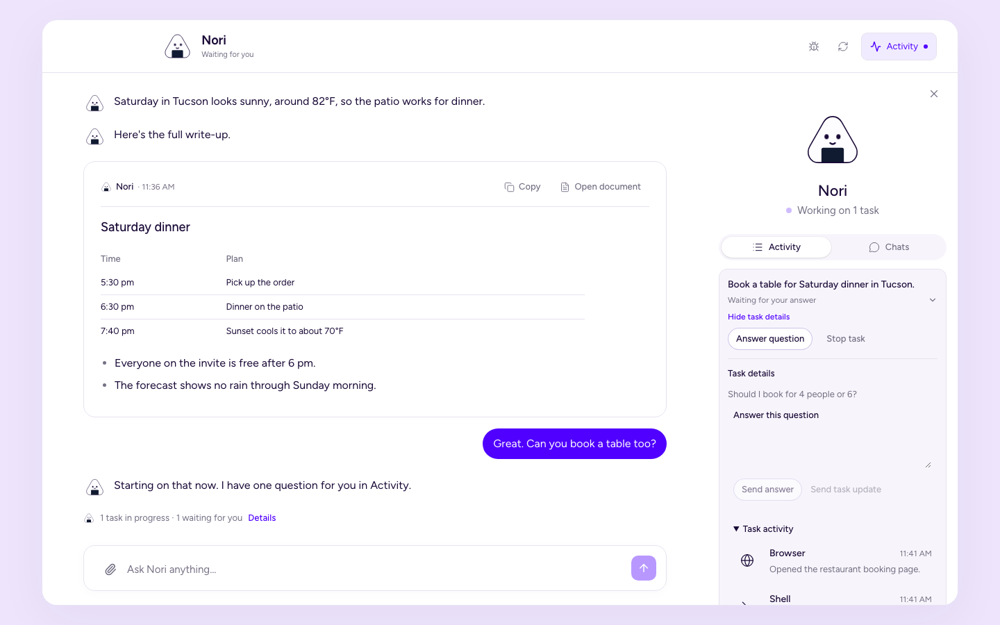
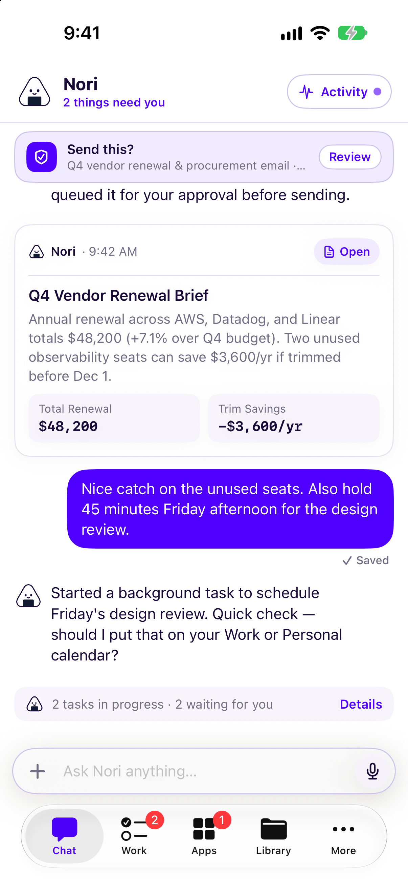
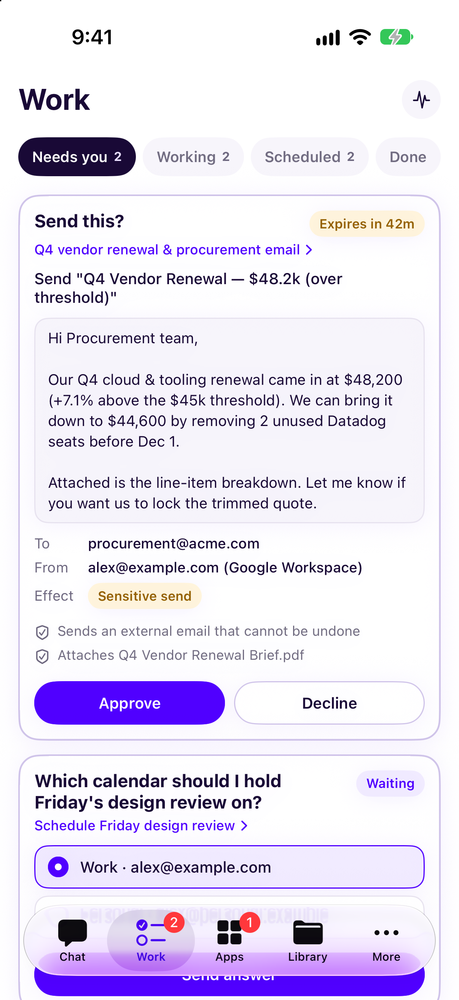
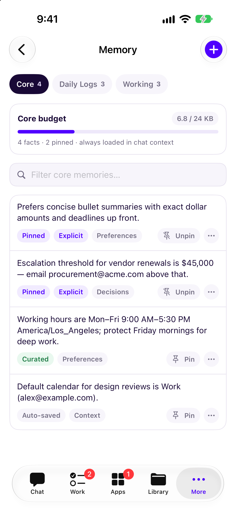

  <h1>🍙 Nori</h1>
  
<strong>One conversation. Everything moving forward.</strong>

  
A persistent assistant that replies right away, spins up durable background work, remembers what matters, and never sends anything sensitive without asking first.

  

 

  
  &nbsp;&nbsp;
  
  &nbsp;&nbsp;
  

---

### Why Nori?

- **Never blocked.** Ask three things at once — Nori answers immediately while independent background tasks run in parallel. Steer, pause, or stop any task mid-flight without derailing the conversation.
- **Ask before acting.** Every external write or sensitive send is bound to an explicit approval card with exact details before a single byte leaves your workspace.
- **Memory you can actually see.** Pin preferences, browse daily episodic logs, and watch working memory stay fresh automatically — no mystery black-box recall.
- **Plug in your tools.** Connect MCP servers, set recurring automations and goals, and keep every brief, table, and artifact saved in your library.
- **Everywhere you are.** Native SwiftUI iOS app, crisp Next.js web client, and Nori for Mac with local Home AI Server support.

### Design System

- **Base foundations (colors, surfaces, mascot, semantic states, accessibility):** [`docs/design-system.md`](docs/design-system.md)
- **iOS SwiftUI design system & Dark Mode guide:** [`ios/DESIGN_SYSTEM.md`](ios/DESIGN_SYSTEM.md)
