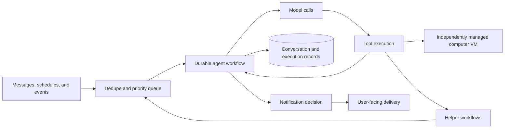

# Grok Bot research

Research cutoff: **October 24, 2026**.

Scope: Grok Bot's agent loop, durable execution, cloud computer, tool discovery, delegation, memory, and notification behavior. The architectural account comes primarily from Lee Robinson's Stanford CS146S lecture. Current product documentation provides a separate check on user-visible behavior. The lecture explicitly includes work in progress; it should not be treated as a complete production specification.

Primary lecture: [Stanford CS146S: How always-on agents work](https://www.youtube.com/watch?v=L1OBRtfPS34). Peter Piekarczyk published a [searchable transcription](https://www.peterp.me/transcripts/how-grok-bot-works/) on October 14, 2026. Timestamped citations below link to the video.

## Product and execution boundaries

Grok Bot presents persistent named agents that accept work through conversation, operate connected applications and a cloud computer, and continue working after the client closes. Current documentation distinguishes each Bot's conversation and learned context from the computer shared by an account. [Product overview](https://docs.x.ai/grok-bot/overview)

Three entities have different responsibilities:

| Entity | Responsibility |
| --- | --- |
| Bot | Persistent identity, role, conversation, and learned context |
| Helper | Delegated work with a separate context and execution lifecycle |
| Computer | Browser, terminal, filesystem, and application sessions used to perform work |

The lecture places the durable agent loop on a server and the computer in a separately managed VM. This allows the computer to sleep or be rebuilt without destroying the conversation or the agent's execution record. [Lecture, 10:06–15:18](https://www.youtube.com/watch?v=L1OBRtfPS34&t=606s)

## System architecture

The following is a conceptual reconstruction of the lecture, not an internal API or deployment diagram:

The agent server and computer have separate lifecycles. Model inference, conversation persistence, workflow recovery, and computer operation are different parts of the system. [Lecture, 12:20–17:20](https://www.youtube.com/watch?v=L1OBRtfPS34&t=740s)

## Event and turn lifecycle

The transcript supports this sequence:

1. A user message, scheduled routine, integration event, or helper result arrives.
2. The service records the input and routes it into the conversation's work queue.
3. Routing deduplicates repeated inputs. Owner messages receive priority; rapid messages can be batched into one turn.
4. The durable workflow resumes with its conversation and execution state.
5. The model receives the current task, relevant memory, instructions, and available tool information.
6. The model calls tools. Work may use an API, a helper, or the computer, which can be started when needed.
7. Tool results and progress are recorded before subsequent decisions.
8. New owner instructions can steer the ongoing work.
9. Results are delivered, held for approval, retained for later, or left silent according to their relevance.
10. When work becomes idle, state persists and the computer can sleep.

The talk does not publish exact event schemas, transaction boundaries, scheduling rules, or interruption semantics. [Lecture, 10:06–18:04](https://www.youtube.com/watch?v=L1OBRtfPS34&t=606s)

“Always on” describes the ability to receive events and continue work without an open client. It does not require continuous model inference while no task is running.

## Durable execution and state

Robinson identifies Temporal as the durable workflow system. Its role is to retain execution progress across worker failures so completed work does not have to restart from the beginning. Helpers are also described as durable workflows. [Lecture, 16:17–17:20](https://www.youtube.com/watch?v=L1OBRtfPS34&t=977s), [Lecture, 23:30–25:09](https://www.youtube.com/watch?v=L1OBRtfPS34&t=1410s)

Four kinds of information should be kept distinct:

| Information | Question it answers |
| --- | --- |
| Model context | What information is available for this decision? |
| Long-term memory | What facts, preferences, and procedures can be retrieved later? |
| Execution state | Which steps have completed, and what should happen next? |
| External effect state | Did the outside service actually perform the action? |

Temporal's documentation makes the same distinction: execution history can restore loop position, while an external system remains authoritative about its own effects. A memory summary cannot prove that a message was sent or a payment completed. [Temporal: Agent memory and state](https://docs.temporal.io/ai/featured/memory-state-stripe)

Durable execution does not make every external action exactly once. An activity may execute again after the service completes a request but the worker loses its response. Side-effecting tools need idempotency or reconciliation against the external system. This is a platform property, not a claim about an observed Grok Bot failure. [Temporal: Activity side effects](https://docs.temporal.io/develop/python/integrations/mcp)

## Computer VM and shared resources

The lecture names Firecracker for the computer VM and describes snapshotting, shutdown, resumption, shell access, a browser, and user control of a live desktop. It does not identify the complete hosting or orchestration stack. [Lecture, 12:20–15:18](https://www.youtube.com/watch?v=L1OBRtfPS34&t=740s)

Current documentation gives a more precise ownership model:

- One user account has one shared computer.
- Bots on that account share files, browser sessions, and command-line credentials.
- Each Bot gets its own screen; one Bot runs one computer-use task on its screen at a time.
- Screens are work surfaces, not security boundaries.
- Connected-app OAuth tokens are held on the connector backend rather than exposed to the Bot.
- Conversations live outside the computer and survive a computer reset.

The documentation distinguishes durable workspace files from replaceable packages and temporary state. [Computer and apps](https://docs.x.ai/grok-bot/computer-and-apps)

A machine snapshot and an agent checkpoint preserve different things. Firecracker snapshots serialize guest memory and machine state, with disk files managed separately. The Firecracker documentation does not guarantee that network connections survive restore. Reconnection and recovery of application-level operations still require explicit handling. [Firecracker snapshot support](https://github.com/firecracker-microvm/firecracker/blob/main/docs/snapshotting/snapshot-support.md)

## Tools and client communication

The lecture describes `send_user` as the model-facing delivery tool. It can represent messages and richer interactions such as drafts, approvals, sign-in requests, files, or reactions. Clients choose how to display those results. This description concerns the agent's delivery interface; it does not imply that the whole application uses a single network endpoint or message type. [Lecture, 18:10–19:58](https://www.youtube.com/watch?v=L1OBRtfPS34&t=1090s)

For tool discovery, the talk describes a small initial interface with tool names or an index, followed by on-demand retrieval of detailed schemas and instructions. This reduces the amount of tool metadata occupying every request. A stable native tool interface can load descriptions as data. [Lecture, 19:58–21:30](https://www.youtube.com/watch?v=L1OBRtfPS34&t=1198s)

The talk also notes that a dedicated tool can be more efficient and easier to inspect than repeated shell commands for a common operation. Useful tool errors identify what failed and what the agent can try next. [Lecture, 25:16–26:27](https://www.youtube.com/watch?v=L1OBRtfPS34&t=1516s)

## Computer-use observation and control

The lecture describes several ways to observe software:

| Observation | Useful information |
| --- | --- |
| Accessibility tree | Named controls, roles, text, and actions |
| Page structure | Browser-specific information available through the selected interface |
| Screenshot | Visual layout, canvas content, and interfaces without useful semantic targets |

Structured element actions can avoid coordinate guesses. Pixel input remains useful when semantic targeting is unavailable. Human takeover handles steps such as verification or an interface explicitly requiring a person. The lecture does not publish the exact selector, actionability, locking, or fallback implementation. [Lecture, 22:40–23:30](https://www.youtube.com/watch?v=L1OBRtfPS34&t=1360s)

The proposed tool-selection order is to use available context, connected APIs, search, browser interaction, or desktop execution according to the task. This is an efficiency heuristic. A required approval or credential handoff remains a boundary regardless of how many other methods are available. [Lecture, 21:30–23:30](https://www.youtube.com/watch?v=L1OBRtfPS34&t=1290s)

## Helpers and coordination

Helpers receive separate working contexts and can perform detailed work without putting every observation into the main conversation. The parent can check, message, or stop them, and receives their results. Separate durable workflows make their execution recoverable independently. [Lecture, 23:30–25:09](https://www.youtube.com/watch?v=L1OBRtfPS34&t=1410s)

Delegation increases the amount of work that can be processed across contexts. It does not create literal infinite context: each helper still has a limit, and its report can omit information. A parent must distinguish a helper's claim of completion from evidence that the requested outcome exists.

Current product documentation also describes persistent Bots coordinating through messages and handoffs. Those persistent identities should be distinguished from the task helpers described in the lecture. [Product overview](https://docs.x.ai/grok-bot/overview)

## Memory, skills, and routines

The lecture describes several layers of stored information:

| Layer | Intended use |
| --- | --- |
| Core profile | Stable facts and preferences included frequently |
| Dated logs | Historical work and conversation details |
| Scratch notes | Short-lived context relevant to current work |
| Skills | Reusable instructions for a procedure |
| Routines | Instructions activated by a schedule or event |
| Other files | Detailed material retrieved when needed |

These layers reduce the need to keep all prior work in the active prompt. Their usefulness depends on retrieval and maintenance, not storage alone. [Lecture, 8:31–10:06](https://www.youtube.com/watch?v=L1OBRtfPS34&t=511s), [Lecture, 32:56–34:25](https://www.youtube.com/watch?v=L1OBRtfPS34&t=1976s)

Current documentation defines a skill as instructions for how to do work and a routine as when a Bot should run it. Demonstration can produce a draft skill, which still needs decision rules, failure handling, validation, and approval boundaries. A recorded demonstration is not evidence of a general, reliable workflow. [Skills and routines](https://docs.x.ai/grok-bot/skills-routines-and-automations)

## Prompt caching and compaction

The lecture's caching strategy has several parts:

- Keep system instructions and native tool definitions stable where possible.
- Use a consistent ordering of prompt sections.
- Retrieve detailed tool information only when needed.
- Put large outputs in files rather than repeatedly resending them.
- Let helpers retain detailed execution context.
- Consider prompt prewarming before the user submits a message.
- Compact during an idle interval while a provider's prompt cache is still warm.

The cache lifetime is provider-dependent. The talk's examples are not a universal TTL. [Lecture, 27:26–32:50](https://www.youtube.com/watch?v=L1OBRtfPS34&t=1646s)

Compaction is lossy. Important retained information includes current intent, accepted decisions, constraints, unresolved tasks, pending approvals, and references to detailed records. Preserving a proposed action is different from recording a confirmed outcome.

Research note: a cache miss can be expected after expiration, a necessary instruction change, or a different serving path. Cache efficiency should be measured without treating an intentionally stale prompt as a successful optimization.

## Review, consent, and notifications

The lecture describes automatic review of tool actions, explicit treatment of untrusted external content, approval for consequential actions, and credential flows outside ordinary model conversation. It also distinguishes doing background work from deciding to notify the user. [Lecture, 26:33–27:26](https://www.youtube.com/watch?v=L1OBRtfPS34&t=1593s), [Lecture, 11:16–12:20](https://www.youtube.com/watch?v=L1OBRtfPS34&t=676s)

Current documentation says Auto Review evaluates tool calls and computer actions. Ask-first rules take precedence over automatic-allow rules. It explicitly describes review as model-based and complementary to least privilege and approval boundaries. Passwords and verification steps use secure input or human takeover, rather than ordinary chat. [Approvals, security, and privacy](https://docs.x.ai/grok-bot/approvals-security-and-privacy)

The notification decision has its own product tradeoff: useful follow-up can become unwanted interruption. The lecture identifies this as unfinished work. No complete notification-scoring function or evaluation procedure is disclosed. [Lecture, 41:08–41:42](https://www.youtube.com/watch?v=L1OBRtfPS34&t=2468s)

## Training and evidence limits

Robinson describes supervised examples of harness use, reinforcement learning for instruction following and tool behavior, and a feedback process that turns observed failures into evaluations and harness changes. A separate cycle trains later models on lessons from those failures. This is a description of the development approach, not a reproducible training recipe. [Lecture, 34:25–37:42](https://www.youtube.com/watch?v=L1OBRtfPS34&t=2065s)

Several claims in the talk need narrower interpretation:

- Its statement that hallucinations are largely solved is not accompanied by a supporting evaluation. It should not be used as a reliability assumption.
- Better automated review does not establish that every action is correctly classified.
- Weeks or months of autonomous work are discussed partly as a future direction, rather than a demonstrated general guarantee.
- Durable recovery preserves execution progress; it does not independently establish external outcomes.
- File-based memory and helper contexts do not eliminate information loss.

## Unresolved questions

- What exact workflow and activity boundaries are used in production?
- How are duplicate external effects detected after an ambiguous failure?
- Which model variants and routing policies handle main turns, helpers, review, and compaction?
- How is computer access coordinated between helpers working for one Bot?
- What information is guaranteed to survive a computer rebuild versus a workflow restart?
- How are stale browser observations and ambiguous action outcomes represented?
- How are memory errors and repeated compaction losses measured over long periods?
- What criteria distinguish a useful proactive update from an interruption?

## Source register

| Source | Evidence type | Main use |
| --- | --- | --- |
| [How always-on agents work](https://www.youtube.com/watch?v=L1OBRtfPS34) | Developer lecture; Lee Robinson, Stanford CS146S | Architecture, harness, and engineering rationale |
| [Searchable transcription](https://www.peterp.me/transcripts/how-grok-bot-works/) | Third-party transcription; October 14, 2026 | Searchable lecture text |
| [Grok Bot overview](https://docs.x.ai/grok-bot/overview) | Official product documentation; updated October 22, 2026 | Persistent Bots and context ownership |
| [Computer and apps](https://docs.x.ai/grok-bot/computer-and-apps) | Official product documentation; updated October 22, 2026 | Shared computer, screens, sessions, and recovery |
| [Skills and routines](https://docs.x.ai/grok-bot/skills-routines-and-automations) | Official product documentation; updated October 22, 2026 | Procedures, demonstrations, schedules, and events |
| [Approvals, security, and privacy](https://docs.x.ai/grok-bot/approvals-security-and-privacy) | Official product documentation; updated October 22, 2026 | Review, consent, and secure handoff |
| [Temporal: Agent memory and state](https://docs.temporal.io/ai/featured/memory-state-stripe) | Platform documentation | Context, memory, execution, and external effects |
| [Temporal: MCP integration](https://docs.temporal.io/develop/python/integrations/mcp) | Platform documentation | Activity retries and idempotency |
| [Firecracker snapshot support](https://github.com/firecracker-microvm/firecracker/blob/main/docs/snapshotting/snapshot-support.md) | Hypervisor documentation | Snapshot contents and restoration limits |
