# Nori complete assistant product and integration plan

Build Nori into a complete personal assistant: connect the user’s apps, understand requests across conversations, execute work across those apps, manage commitments over time, deliver updates when the user is away, and make every connection, task, result, and permission understandable in the product.

Keep the Go and Temporal engine. Implement the agreed architecture—Extension registry, Connections, and App connectors/MCP client—as the shared foundation for the full product. Tool definitions, connection state, execution authority, and plugin packaging have distinct responsibilities, but they belong to one coherent execution system.

This is the complete target plan. Calendar, email, multi-account support, plugins, custom MCP, reminders, routines, monitors, goals, Library, voice, mobile use, and computer handoff are included. Dependencies define engineering order; they do not remove work from scope or require a new product decision to include it. Completion means the complete acceptance matrix passes, not that one representative integration works.

Austin has accepted the architecture. The detailed feature contracts below are the recommended implementation specification. This is planning work, not a claim that those features have been implemented.

Implementation uses four independent Codex threads: Astra High for coordination and three GPT-6.1 Sol Max threads for backend, frontend, and integration/verification. Engineers own their work and can challenge the plan. Any Astra–Sol disagreement is surfaced to Austin for guidance; neither model has a casting vote. The [coordination model and launch prompt](#four-thread-coordination-and-launch-prompt) define this arrangement. The [contract location map](assistant-contract-locations.md) identifies existing boundaries and the places where new work must connect, without specifying new contract shapes.

The source assessment uses Nori at `c539313` and Pi at `415be829`. Competitor findings come from the live Grok Bot, Muse, and Nori walkthroughs in this conversation. The [original audit](https://chatgpt.com/space/page_d55906d0d9c48191b7afd321f251cde9) supplies the 44-item feature inventory. Application code and production are unchanged.

## Finished product

A user can open Nori, connect personal and work accounts, and ask: “What does my week look like, find the reservation email, move the conflicting appointment, tell the people involved, and remind me before I leave.” Nori carries the context across follow-ups, identifies the right accounts and people, executes the authorized changes, presents source-backed results, and delivers the reminder when the app is closed.

The same product supports research, files, documents, task systems, and custom tools. Users can install plugins, configure MCP servers, create reusable skills, and manage what each can access. They can inspect active work, answer questions, correct instructions, stop tasks, recover from failures, and retrieve or revise prior output.

| Product area | Complete target behavior |
| --- | --- |
| Apps | Searchable catalog, connection setup, multiple accounts, resource selection, health, repair, disconnect, and action history. |
| Plugins | Discover, install, configure, enable/disable, update, pin, roll back, uninstall, and inspect contributions and permissions. |
| MCP | Remote HTTP and managed stdio servers, OAuth and configured credentials, discovery, tools/resources/prompts, capability negotiation, diagnostics, lifecycle management, and custom setup. |
| Calendar | Agenda, search, availability, conflicts, creation, updates, cancellation, invitations, RSVP, recurrence, multiple calendars, time zones, and event-relative reminders. |
| Email | Search/read, attachments, threads, drafts, replies/forwards, authorized send, labels/folders where supported, follow-up tracking, and email-to-calendar/task workflows. |
| Reminders and routines | One-time, recurring, event-relative, and conditional work; edit, snooze, pause, cancel, next-run visibility, and delivery tracking. |
| Goals and monitors | Explicit commitments, progress, blockers, next actions, change detection, meaningful notifications, and completion/stop conditions. |
| Conversation | Shared capabilities across chats, natural follow-ups, targeted corrections, structured questions/actions/results, attachments, dictation, and voice. |
| Work and computer | Concurrent tasks, visible progress, input routing, takeover for sign-in, resume, cancellation, and actionable partial failures. |
| Library and search | Saved results, files, sources, versions, previews, revision/export, and search across conversations, tasks, and artifacts. |
| Preferences and trust | Editable memory, account defaults, time/working hours, permission rules, notifications, costs, retention controls, and inspectable action evidence. |
| Multi-device use | Complete responsive desktop/mobile behavior, synchronized state, closed-app notifications, and deep links to the relevant work. |

Retain the current runtime’s durable ownership, task revisions, cancellation, receipts, and computer isolation. Extend the current frontend rather than changing frameworks. Reuse retired calendar/email/scheduling code where it still fits the current contracts; port useful behavior instead of blindly reverting its removal. [Retired functionality](https://github.com/a-barwick/nori/commit/ec38dfe6df9df025dc78ee0a374293178d518533).

## Current implementation and missing pieces

| Area | Built now | Missing or insufficient |
| --- | --- | --- |
| Tool definitions | Static definitions combine schemas, capability group, access mode, and execution policy. | An extensible registry and generic adapter resolution. |
| Capability discovery | Six groups: web search, browser, attached files, saved results, memory and conversation, shell. Nondefault capabilities can be loaded. | Stable capability IDs, account-specific state, generic deferred discovery, and a matching UI inventory. |
| Invocation | Runtime and computer operations have established execution paths. | External integrations still require code in named dispatch switches. |
| Schemas | Object, string, array, boolean, enum, required fields, and nested properties. | A deliberate strategy for broader JSON Schema and provider compatibility; current types cannot faithfully represent arbitrary MCP tools. |
| Operation durability | Admission, task revision checks, saved outcomes, uncertain-write handling, cost accounting, and cancellation. | Integration identity, provider receipts, verification/reconciliation, and versioned dynamic tool policy. |
| Identity and secrets | User identity comes from verified sign-in or durable work; a secret lookup interface exists. | Account connections, grants, refresh coordination, revocation, and an explicit per-user credential lifecycle. |
| Calendar and email | No current native adapters in the reviewed catalog. | Connection flow, reads, writes, source links, and provider-specific semantics. |
| Future work | Worker/conversation wake mechanisms and durable running tasks. | Due-time wake, schedule definitions, delivery state, and visible reminder management. |
| Conversation | Main assistant, separate chats, files, task steering, input requests, and Stop. | Clear capability boundaries, structured connection/action cards, and concise useful progress. |
| Saved work | Results, versions, downloads, image/PDF display, and Markdown viewer. | Searchable Library, obvious revision/export controls, and cross-task retrieval. |
| Product shell | Activity and Chats panels, responsive components, read positions, accessible announcements. | Apps, reminders/routines, preferences, actionable connection health, and consistent branding. |

The existing `Capability.Account` and `Availability` fields are presentation strings, not an account model. `TaskToolPolicy` is a global lookup by name, and workflow behavior depends on it. These are adequate for a fixed built-in set but need a controlled boundary before dynamic tools are introduced. [Catalog](https://github.com/a-barwick/nori/blob/c53931359ac2e0f95dacb5368c517cb3cde976a9/core/internal/agent/catalog.go), [tool definitions](https://github.com/a-barwick/nori/blob/c53931359ac2e0f95dacb5368c517cb3cde976a9/core/internal/agent/tools.go), [schema](https://github.com/a-barwick/nori/blob/c53931359ac2e0f95dacb5368c517cb3cde976a9/core/internal/transcript/tool.go), [workflow](https://github.com/a-barwick/nori/blob/c53931359ac2e0f95dacb5368c517cb3cde976a9/core/internal/task/workflow.go).

Preserve the operation path instead of introducing an independent MCP job runner. It records authority and outcomes separately from debug traces, checks revisions, and handles saved receipts before starting further work. [Durable tool execution](https://github.com/a-barwick/nori/blob/c53931359ac2e0f95dacb5368c517cb3cde976a9/core/internal/task/tool_durable.go).

The side-chat limitation is a concrete usability defect: it presents the same broad composer prompt while its agent excludes browser, shell, and background tasks. The calendar-export fallback is another: the current uploader excludes standard ICS files. Give separate chats the same Available tools and Tool executor as the main assistant, while preserving their separate conversation context. Add ICS handling and ensure every suggested fallback is supported by the uploader. [Chat prompt](https://github.com/a-barwick/nori/blob/c53931359ac2e0f95dacb5368c517cb3cde976a9/core/internal/prompts/chat.txt), [app](https://github.com/a-barwick/nori/blob/c53931359ac2e0f95dacb5368c517cb3cde976a9/web/src/components/runtime/NoriApp.tsx), [uploads](https://github.com/a-barwick/nori/blob/c53931359ac2e0f95dacb5368c517cb3cde976a9/core/internal/state/uploads.go).


## Grok Bot functionality and product lessons

The native Grok Bot walkthrough established the controls below. “Observed” means the interface was inspected; it does not mean an OAuth round trip, external write, or scheduled delivery was successfully exercised.

| Functionality | Observed Grok behavior | Nori implication |
| --- | --- | --- |
| App discovery | Searchable Connect apps catalog with categories and connected labels. | Apps must be reachable from navigation and from a blocked request, with searchable categories and accurate availability. |
| Installed extensions | Your plugins distinguishes installed packages, including connectors and reusable skills. | Show what is installed, what it contributes, and whether required accounts are connected. |
| Calendar accounts | Calendar details expose connection state, account identity, Add Another Account, and uninstall. | Support multiple connected accounts, resource selection, and default destinations. Separate disconnect from uninstall. |
| Repeated work | Routines have readable cadence and pause controls. | Give reminders/routines a durable home, next run, last result, and edit/pause/cancel controls. |
| Saved outputs | Library exists independently of conversation history. | Expose the result storage Nori already has instead of requiring transcript archaeology. |
| Computer work | Computer is a distinct destination in bot details. | Provide computer status, session visibility, sign-in handoff, takeover, resume, and Stop controls. |
| Permissions | Settings expose approval modes and custom permission rules. | Provide clear action boundaries and bounded exceptions tied to real targets; avoid asking repeatedly for an unchanged authorized action. |
| Input | Attachment, voice input, and voice-chat controls are visible. | Provide attachments, dictation, and voice conversation with visible transcripts and action state. |

The strongest lesson is lifecycle completeness: a user can discover an integration, inspect its account, manage recurring work, and retrieve outputs. Merely exposing a calendar tool to the model would reproduce only one part of that experience.

Do not copy every Grok control or claim equivalent reliability. The capability-only probe explicitly prohibited private reads, yet Grok’s answer reported checking free/busy information. The tool trace was not inspected, so actual access is unconfirmed. This motivates a specific Nori acceptance case: explaining capabilities must use metadata and make no private-data calls.

The walkthrough did not establish Grok’s MCP installation behavior, plugin sandboxing, retry semantics, account-isolation implementation, or exactly-once writes. Those cannot be inferred from the catalog. Nori’s architecture decisions should rest on its own requirements and verification.


## Muse as a secondary comparison

Muse’s web interface exposes connectors, activity, approvals, goals, and a searchable Library. Its Calendar connection explanation describes access before the Connect action, and permission settings distinguish connector and web controls. The useful patterns are clear prerequisites, visible pending decisions, and durable work outside the transcript.

Muse’s assistant described a chat-assisted custom MCP flow, but installation was not exercised and no generic server configuration pane was observed. Some navigation labels in its answer differed from the visible interface. Use this as evidence for state-driven capability explanations rather than hardcoded model descriptions.

Goals retain an adopted commitment across failed attempts. Nori should include an explicit goals model with outcomes, progress, blockers, related tasks, follow-ups, and completion criteria, alongside reminders and task results. [Muse design rationale](https://muse.ai/blog/how-we-designed-muse).


## What Pi implements

Pi separates the harness, transport libraries, and application experience.

| Pi component | Implemented responsibility | What Nori should borrow |
| --- | --- | --- |
| Durable extension registry | Named bundles of tools, prompt sections, hooks, wrappers, and tasks; install/remove and immutable registry snapshots. | A registration boundary with stable names, versioned definitions, and controlled replacement. |
| Durable tool registration | Schema, execute function, replay policy, caller exposure, deferred loading, and output limits. | Definitions that travel through a generic executor instead of tool-name switches. |
| Durable execution | Tool intent is stored before execution; recovery depends on declared replay safety. | Keep side-effect and recovery semantics explicit for every adapter. |
| Tool discovery | Deferred tools can be loaded through search; enabled and model-visible tools are distinct. | Keep large integration catalogs out of every model request. |
| Pi MCP library | Protocol client, stdio/HTTP transports, discovery, invocation, and OAuth helpers. | Keep MCP behind an adapter and own account persistence separately. |
| Pi coding agent | Server configuration, connection inspection, sign-in/out, reconnect, and exposure controls. | Connection management belongs in the product, above the protocol client. |

The registry is application-owned. Conversations store extension names; they do not persist executable extension code. A registry install is therefore not a complete consumer plugin-installation workflow. [Registry implementation](https://github.com/earendil-works/pi/blob/415be8290a7869456c0582ae6e5e8ea5152f2f40/packages/durable/src/harness/registry.ts), [extension and tool types](https://github.com/earendil-works/pi/blob/415be8290a7869456c0582ae6e5e8ea5152f2f40/packages/durable/src/harness/types.ts).

Pi’s tool contract separates replay safety from model visibility, validates arguments, and supports model output, programmatic structured output, and UI details. Those are useful boundaries for Nori’s result contract. Deferred visibility is not authorization. [Tool definitions](https://github.com/earendil-works/pi/blob/415be8290a7869456c0582ae6e5e8ea5152f2f40/packages/durable/src/harness/types.ts), [Durable tools and discovery](https://github.com/earendil-works/pi/blob/415be8290a7869456c0582ae6e5e8ea5152f2f40/packages/durable/README.md#tools).

The MCP library leaves credential storage and browser behavior to the host. The coding-agent application supplies its own configuration files, token handling, and management UI. Nori needs its own authenticated, per-user equivalent suited to a hosted assistant; copying a single-user CLI credential file is not appropriate. [Pi MCP library](https://github.com/earendil-works/pi/blob/415be8290a7869456c0582ae6e5e8ea5152f2f40/packages/mcp/README.md), [Pi coding-agent MCP controls](https://github.com/earendil-works/pi/blob/415be8290a7869456c0582ae6e5e8ea5152f2f40/packages/coding-agent/docs/mcp.md).

Pi is an architecture reference, not a reason to replace Nori with a TypeScript runtime or copy Pi’s scheduler. Its dynamic reload behavior also does not automatically satisfy Temporal workflow replay. Preserve Nori’s deterministic historical decisions and current authorization checks.

Pi also supports tools calling other tools as owned durable tasks and a code mode that journals tool results for restart recovery. Nori should support programmatic composition for workflows that combine or filter many tool results. Every nested call must retain its own authority, limits, receipt, and recovery behavior. Extension hooks should have defined contracts for policy checks, context contribution, result normalization, and lifecycle events. [Nested calls and code mode](https://github.com/earendil-works/pi/blob/415be8290a7869456c0582ae6e5e8ea5152f2f40/packages/durable/README.md#calling-tools-from-tools).


## Architecture and ownership

Use the agreed three-part integration model:

1. **Extension registry:** stable definitions for tools, instructions, hooks, UI metadata, and executable bindings.
2. **Connections:** a user’s accounts/endpoints, grants, selected resources, credential references, and health.
3. **App connectors, MCP client, and Computer runtime:** the execution backends for provider APIs, MCP servers, browser work, and managed processes.

A plugin is a versioned installable package contributing extensions and skills. A capability is a resolved user-facing description of what is usable. A skill is reusable instructions with declared inputs and required capabilities. None grants authority merely by being installed or mentioned.



The [editable diagram](diagrams/assistant-architecture.mmd) uses responsibility boundaries, not deployment boundaries. Solid arrows show requests, execution, and results. Dashed arrows show configuration, available tools, and authorization dependencies. This is the target architecture; the [contract location map](assistant-contract-locations.md) distinguishes existing implementation from missing boundaries.

The Agent runtime includes the conversation agent and task agents. The conversation agent maintains the user conversation, resolves the intended task, presents prerequisites, and routes answers/corrections. Task agents select from Available tools and submit work to the Tool executor. Permission checks use current Connections before an external attempt. The Tool executor owns durable admission, dispatch, retries, and outcome recording.

App connectors and remote calls through the MCP client run without waking the Computer runtime. The Computer runtime handles browser work and managed processes when required, including hosted stdio MCP processes. Automations feed the Scheduler, which starts or resumes work in the Agent runtime. Execution records preserve provider evidence and receipts for the Nori app and subsequent agent work.

The Extension registry owns definitions; Connections owns account state; the Tool executor owns execution and outcomes. Account settings manages Connections. The Nori app presents conversation, Apps, Work, and Library using Available tools and Execution records. Do not maintain separate tool lists in prompts, settings, and task code.

Use these component names throughout implementation discussions and contract proposals. Qualifiers such as versioned, per-user, and durable describe requirements; they are not part of component names.

Reserve internal orchestration names such as completion, task delegation, and input requests. External extensions cannot shadow them or another provider’s tool. Durable task creation and lifecycle remain explicit engine operations even when exposed through a tool.

Use shared in-process contracts and existing storage for these responsibilities. Separate deployment units only where execution isolation requires them, such as untrusted plugin code or local MCP processes.

## Registry tool SDK and composition

Replace the static tool list and provider-specific switches with registered definitions. Migrate every existing built-in tool, preserving its external name, effect classification, cost handling, and historical compatibility. Native and MCP tools use the same validation, admission, invocation, output, and recovery contracts.

Each tool definition includes:

- Stable internal ID, model-facing alias, extension/version, description, and capability grouping.
- Original input JSON Schema, optional structured-output schema, provider-compatible model schema, and explicit schema adaptation rules.
- Execution binding, required connection type, supported account/resource scope, and required authorization.
- Effect classification, replay/reconciliation policy, timeouts, cancellation semantics, cost metadata, and output limits.
- Direct, discoverable, programmatic-only, or disabled exposure, independent of whether the tool is authorized.
- Progress/result presentation metadata and documented error categories.

Preserve schema semantics. Support numbers, integers, nullable values, nested arrays/objects, enums, additional-property constraints, and supported composition/reference constructs. Validate against the canonical schema; transform only the model-facing schema when required by the model provider. Unsupported constructs must be visible errors rather than silently weakened constraints.

Provide capability and tool search with descriptions, examples, account state, and required access. Load relevant schemas into model context on demand. Keep the visible ordering stable for caching, record the selected definition version, and avoid exposing unrelated private account details during discovery.

Provide typed results with separate model content, structured data, UI details, evidence references, and artifacts. Cap oversized content and make the retained source retrievable. Rich outputs include text, images, files, resource references, and media when the client can display them; unsupported media receive a useful fallback.

Implement nested tool calls for cross-app workflows and programmatic batching. Each call has a stable identity, parent task, its own authority check and receipt, bounded concurrency, and cancellation ownership. A script restart reuses recorded results and cannot replay completed writes. Version the script/runtime and detect divergent replay. Programmatic execution gets tool handles, not unrestricted credentials or network access.

Expose extension hooks for context contribution, pre-invocation policy, progress, result normalization, and task lifecycle. Hooks run within defined deadlines and cannot silently bypass the durable executor. Provide an authoring SDK, schema checks, local harness, fixtures, and examples for a native integration, an MCP package, an instruction-only skill, and a UI result renderer.

## Plugin and skill system

Ship a searchable plugin catalog and support installation from a configured registry, repository/package reference, or local package upload. Each source resolves to an immutable package version with provenance and integrity verification. Public availability, installed state, enabled state, and account connection state are separately displayed.

The manifest contains identity, publisher/source, version, compatible Nori contract version, description, categories, tools, skills, prompts, adapters/MCP servers, runtime requirements, dependencies, requested access, UI contributions, and setup examples. It declares migrations and uninstall behavior when the package owns state. Resolve dependencies and detect conflicts before activation.

The full installation flow is: inspect package → review contributions and access → resolve dependencies → install version → connect required accounts → configure resources → validate readiness → return to the originating request. Users can install an instruction-only package without inventing an account connection.

Updates show changed tools, schemas, instructions, dependencies, and requested permissions. A package update cannot silently acquire new account access or replace the definition underneath a recorded operation. Support version pinning, rollback, disablement, and removal. Keep historical receipts and artifact readers available when a package is removed; explain dependencies such as affected routines and goals.

Executable third-party packages run in an isolated runner with declared filesystem/network capabilities, resource limits, managed dependency installation, cancellation, and redacted diagnostics. First-party compiled adapters can remain in-process. Both paths enter the same durable invocation contract. UI contributions use documented components or an isolated renderer; a plugin cannot inject unrestricted code into the main application.

Skills have names, descriptions, inputs, instructions, required capabilities, examples, and versions. Users can create/edit/import/export skills, invoke them deliberately, attach them to routines, and scope them to chats or projects. Loading a skill does not install code, read private sources, or grant permissions. A skill run records the version and user parameters so the result can be understood later.

Catalog search supports categories, installed/available filters, connection requirements, and examples. Package details show publisher/source, version, permissions, tools, skills, settings, health, and update history. Publish a package format and developer guide so extending Nori does not require patching agent internals.

## Connections and account settings

Implement a complete account lifecycle: discover provider, explain access, start sign-in, handle cancellation, validate callback, identify the account, persist the grant, select resources, verify readiness, and resume the originating request. Bind each connection attempt to the authenticated Nori user, intended provider, callback state, and expiry.

Support multiple accounts per integration, account labels, per-operation defaults, explicit selection, and disambiguation. Calendar read sets can span several calendars/accounts while writes target one selected calendar. Email sends use the chosen sender identity. A reconnect cannot silently substitute a different account.

Store granted scopes separately from desired capabilities. Request additional access when enabling an operation that needs it. Calendar access must not implicitly request unrelated email sending. Health distinguishes ready, connecting, disconnected, disabled, needs sign-in, needs more access, rate-limited, and temporarily failing.

Project application credentials remain in the prescribed project/server environment files. User grants use an explicit per-user credential store with create/update/read/delete, refresh locking, revocation, and audit metadata. The existing secret lookup is a read interface and needs this lifecycle added or composed behind it. Select the backing deployment mechanism without copying credentials into prompts, ordinary records, plugin manifests, browser persistence, or telemetry. A storage choice that is not settled by project policy requires Austin’s decision before actual credentials are written. [Secret boundary](https://github.com/a-barwick/nori/blob/c53931359ac2e0f95dacb5368c517cb3cde976a9/core/internal/secret/secret.go).

Coordinate refresh per connection to avoid concurrent token races. Retry transient provider errors with bounded backoff; distinguish revoked access, insufficient scope, rate limits, and malformed requests. The connection UI shows last successful use, concise error, affected capabilities, and repair actions.

Disconnect blocks future calls immediately, revokes remotely where supported, removes local credential access, and identifies impacted routines. Uninstalling a plugin is a different action. Historical results retain their source/account attribution subject to the user’s retention choices.

Expose the same resolved inventory to the assistant and UI. “Can you use my calendar?” is answered from installation, connection, and permission metadata. It does not require reading events or free/busy data.

## MCP client and server support

Implement the MCP client with remote Streamable HTTP and managed stdio transports. The stdio process runs in the user’s managed computer or isolated execution environment, with explicit command/arguments, working directory, environment references, process health, restart policy, and owned shutdown. A hosted worker must not pretend it can execute on the user’s laptop without a local bridge.

Support user-created server configurations and plugin-provided configurations. Import common server definitions with a preview of resolved settings and unsupported fields. Store secret references rather than literal credentials in exported configuration. Support OAuth where the server implements it and explicit configured authentication where needed.

The compatibility contract covers initialization/version negotiation, paginated discovery, tool invocation, structured content, resources and resource templates, prompts, progress, cancellation, timeouts, server notifications, tool/resource-list changes, and session reconnection. Implement roots and interactive elicitation with explicit user-scoped boundaries. Sampling and remote task/polling capabilities require the same model budgets and durable task ownership as ordinary Nori execution; negotiate only features actually implemented.

Discovery occurs outside deterministic Temporal workflow code. Registered tools receive stable namespaced identities, original schemas, provenance, and definition versions/fingerprints. Changed metadata updates future discovery without silently changing a pending operation or granting access to new tools.

The management UI lists servers, transport, source, enabled state, authentication status, exposed tools/resources/prompts, last successful call, and current errors. Support add/edit/delete, connect/reconnect, sign-in/out, start/stop/restart for managed processes, per-tool exposure, diagnostics, and configuration export.

Preserve external content as untrusted data. Bound output, validate result shape, support source/artifact references, and isolate custom UI rendering. Apply deployment network boundaries to endpoints so custom URLs cannot become unintended access to infrastructure metadata. Process cancellation is not proof that a remote write did not happen.

Also expose a Nori MCP endpoint for authorized external clients: search/read Library, inspect tasks/goals/routines, submit work, answer a pending question, and perform supported management actions under the same user authority. The endpoint is an adapter over Nori’s application services, not direct database access. Namespace read and mutation operations clearly, issue scoped credentials, retain operation identity, and publish its compatibility contract.

Use maintained protocol libraries where they meet the requirements. Record supported versions and features, run interoperability checks against independent servers/clients, and surface unsupported features explicitly. The transport specification does not replace Nori’s access model or product UI. [MCP tools](https://modelcontextprotocol.io/specification/2026-07-28/server/tools), [MCP authorization](https://modelcontextprotocol.io/specification/2026-07-28/basic/authorization).

## Integration coverage and provider contracts

Implement the following integration families. Each catalog entry declares its actual provider-supported operations, authentication requirements, resource limits, freshness, and verification behavior. Provider coverage is not satisfied by a logo or a successful connection test.

| Family | Provider targets | Required workflows |
| --- | --- | --- |
| Calendar | Google Calendar, Outlook/Microsoft 365, and iCloud Calendar. | Read/search, availability, create/update/cancel, recurrence, participation, and linked reminders within provider capabilities. |
| Email | The user’s HEY account, Gmail, and Outlook/Microsoft 365. | Read/search threads and attachments, compose/draft/reply/forward/send, organize mail where supported, and follow up. |
| Files and documents | Local uploads/results plus Google Drive, OneDrive, Dropbox, and Notion through maintained adapters or MCP packages. | Find/read, cite sources, create/update/export where supported, preserve versions and sharing boundaries. |
| Tasks and projects | Nori goals/tasks plus Linear and GitHub through adapters or MCP packages. | Search/read work, create/update authorized items, associate source and result, and monitor status. |
| Messaging | Slack and Teams through adapters or MCP packages. | Search/read permitted conversations, draft/send authorized messages, identify recipient/channel, and track replies where supported. |
| Custom tools | User-supplied MCP servers and plugin packages. | Configure, inspect, authorize, invoke, recover, and manage without editing Nori source. |

For Google and Microsoft use provider APIs where calendar/mail semantics and write verification justify a native adapter. Microsoft Graph supplies calendar and mail APIs; organizational and personal-account capabilities must be represented accurately. [Calendar](https://learn.microsoft.com/en-us/graph/outlook-calendar-concept-overview), [mail](https://learn.microsoft.com/en-us/graph/outlook-mail-concept-overview).

For iCloud, implement the supported third-party account authorization path available to the application, with app-specific credentials where required. Include revocation and account-password-change recovery. Apple documents both supported-app authorization and app-specific passwords; do not treat a primary Apple password as a project key. [Apple account authorization](https://support.apple.com/en-us/102654).

HEY’s integration path must be resolved against its supported tooling and the user’s actual account. The existing observed HEY plugin is evidence of an integration in Grok, not proof of a public HEY API usable by Nori. Inspect the available CLI/plugin implementation and choose its supported API, managed command adapter, or explicit browser interaction. Track unavailable provider operations as concrete compatibility gaps; do not silently substitute Gmail for the user’s inbox.

For documents, messaging, and project tools, evaluate maintained MCP packages and existing APIs against the workflow contract. The same catalog and connection screens apply regardless of transport. A provider limitation remains visible in the capability matrix; it does not invalidate the rest of the integration family.

## Calendar workflows

Provide an agenda view and conversation tools over selected calendars, with clear account attribution. Support date-bounded search, free/busy, overlapping events, working hours, buffers, all-day events, location and meeting links, and natural follow-ups such as “also Monday.” Preserve IANA time zones and distinguish a floating local date from an absolute instant.

Implement create, update, move, cancel, invite, RSVP, and recurring-event changes. Distinguish an occurrence, following occurrences where supported, and the whole series. Explain notification effects and resolve ambiguous participants/calendars before acting. Do not silently overwrite a provider-side edit made after Nori prepared the change.

Availability combines the user-selected calendars and known participant access. Unknown availability is not free time. Support proposals with several slots, attendee identity resolution, working-hour preferences, and explicit appointment duration. A proposed slot and a booked event have different states.

Persist operation identity and provider references; use supported idempotency or stable IDs and reconcile uncertain outcomes. Read back the canonical event, including time zone, calendar, attendees, and recurrence scope, before presenting a confirmed result. The result card opens the event and exposes its source, change summary, and associated reminder.

Maintain synchronized event state for event-relative reminders, routines, and monitors. Use provider change notifications/incremental sync where available, with channel renewal, pagination, invalid-cursor repair, and bounded polling when necessary. A notification signals change; fetch authoritative state before acting. Moving or canceling an event updates or cancels linked work. [Google recurrence](https://developers.google.com/workspace/calendar/api/guides/recurringevents), [change notifications](https://developers.google.com/workspace/calendar/api/guides/push), [incremental sync](https://developers.google.com/workspace/calendar/api/guides/sync).

Support ICS upload/import/export with preview, time-zone handling, recurrence parsing, and duplicate detection. A file import is not a live account connection. Calendar cards and uploaded events must preserve that distinction.

## Email contacts and cross-app workflows

Search mail by sender, recipient, subject, date, attachments, and thread context. Return source-linked messages with account attribution and distinguish a snippet from the full message. Retrieve attachments through the same content pipeline as uploaded files. Avoid repeatedly indexing or exposing entire mailboxes when a bounded query answers the request.

Implement compose, draft, edit draft, reply, reply-all, forward, and authorized send. Preserve sender identity, To/Cc/Bcc, thread references, attachments, and quoted context. A draft is not a send. Show the concrete recipients and final content when review is needed, and reuse an already sufficient authorization without repeated prompts.

Handle sent-but-unacknowledged outcomes through provider evidence. Reconcile duplicates, concurrent edits, missing attachments, invalid recipients, insufficient grants, and account changes. Show partial success when a message was sent but a follow-up calendar operation failed. Never describe a multi-step workflow as complete when a required action remains unresolved.

Provide contact lookup across authorized sources with stable source references, names, addresses, and disambiguation. Choosing “Alex” must resolve the intended person; interaction history can suggest candidates but cannot silently overwrite an explicit recipient.

Support mail organization according to provider capability: read/unread, archive, folders/labels, and task/follow-up associations. Bulk operations include a reviewable selection and limits. Preserve provider-specific semantics rather than forcing unlike actions into one misleading universal operation.

Implement complete cross-app recipes:

- Reservation email → extracted itinerary → conflict check → calendar event → departure reminder.
- Incoming scheduling request → candidate slots → draft response → authorized send → booking and follow-up.
- Meeting → source documents and prior messages → preparation brief → notes → assigned tasks and follow-ups.
- Requested project update → issues and messages → saved report → authorized distribution.
- Unanswered sent message → user-authorized monitor → relevant reminder or drafted follow-up.

Each recipe uses the shared task graph and retains its source references, intermediate outputs, authorization, and provider receipts.

## Automations reminders routines monitors and goals

Store future work as durable definitions with human-readable intent, owner, time zone, schedule/trigger, connections, inputs, delivery preferences, budget, revision, and state. Each occurrence has a stable identity and linked task executions. Expose both the definition and its run history.

Support one-time reminders, recurring schedules, event-relative offsets, conditional triggers, and bounded monitors. Users can create these in conversation or the UI, preview the next run, edit, snooze, pause, resume, cancel, and choose an end date or stop condition. Calendar-relative reminders track the event’s stable identity and recurrence instance.

Implement due-time scheduling and repair against persisted state. The current wake contract wakes conversation/worker work but has no delayed scheduling interface. Due work must wake the correct immutable worker build even when no worker is polling. Duplicate or lost wakes must not lose the definition or repeat a settled occurrence. Keep browser compute idle unless the scheduled task actually needs it. [Current wake contract](https://github.com/a-barwick/nori/blob/c53931359ac2e0f95dacb5368c517cb3cde976a9/core/internal/wake/wake.go).

Provide in-app inbox and push notifications, with configured email delivery where desired. Store execution and delivery separately: pending, running, completed, delivery queued, accepted, failed, and acknowledged where detectable. “Provider accepted” is not proof the user read it. Deep links open the relevant task/result and allow Answer, Snooze, or Stop.

Respect quiet hours, urgency, device preferences, and user-selected escalation. Deduplicate repeated observations; summarize low-priority changes; do not send a new message when a monitor found nothing meaningful. Show failures and late deliveries rather than quietly marking them done.

Goals represent explicitly adopted outcomes, not inferred wishes. Store completion criteria, current progress, next actions, blockers, related tasks/artifacts, deadlines, and follow-up policy. A failed attempt does not erase the goal. A completed goal stops its monitors unless the user requested ongoing maintenance. Users can edit, pause, complete, or abandon it.

Provide a goals view and a routines view, with links between them. A morning briefing can combine agenda, urgent messages, due tasks, and goal blockers using fresh authorized sources. Every proactive item has a reason, evidence, and dismiss/snooze/stop behavior. Remembered preferences do not silently create commitments.

## Conversation work overview and computer control

Use one assistant capability model across the main conversation and topic chats. Separate chats keep their own transcript/context and can selectively reference shared memory or Library items under the user’s permissions. Remove the current hidden distinction that gives a familiar composer an unexpectedly powerless agent.

Support reply-to-message/task, edit or correct requests, retry failed generation, branch a topic, search history, and jump to the source. Historical edits must not replay completed external actions. Resolve “that one,” “use Thursday,” and “also Monday” against explicit message/task context; ask a focused question only when genuinely ambiguous.

Render typed parts for connection requests, questions, approvals, progress, calendar events, mail drafts, routines, goals, files, and outcomes. Each card references server-side state and has working actions. Updating a task updates its card instead of adding multiple administrative acknowledgments. Older clients receive meaningful fallback text.

Work shows Needs you, Working, Scheduled, and Finished with concise titles, outcomes, timestamps, source links, and direct controls. Several tasks can run while another waits. Pending answers carry question/task/revision identity and cannot be consumed by the wrong task. Stop affects owned work and shows anything already completed or still uncertain.

Provide a Computer view with current session/status, relevant screen, active task, access state, and user handoff. Support takeover for sign-in, resume after takeover, copy/download of task outputs, and explicit ownership when several tasks need the same browser/session. Do not let a background task interact with a screen the user is actively controlling without an agreed ownership transition.

Browser fallback uses the same request authority and operation records as a native integration. Show when Nori is using the browser, what is blocked, and what evidence supports the outcome. Passwords and sensitive sign-in steps remain in the appropriate credential or interactive surface, not chat transcripts.

Improve the composer with drag/drop, pasted images, previews, supported-type/size guidance, upload progress, retry/cancel, and persistent unsent drafts. Support the complete planned content set—images, PDF, CSV, text/Markdown, ICS, common office documents, and audio—with type-specific parsing and explicit errors.

Implement dictation and voice conversation with a visible transcript, interruption, listening/speaking state, and continuity into text. Voice commands use the same action/approval rules and task state; a transcription error cannot silently change the account, recipient, or date of a consequential action.

## Library search memory and preferences

Make Library the durable home for results, uploads, generated files, source links, and revisions. Each item has a title, type, owner, related conversation/task/goal, timestamps, source provenance, and version history. Provide preview, open, download/export, revise, rename, organize, and delete controls with clear effects.

Search across permitted conversations, tasks, goals, files, and saved outputs. Return snippets and jump links to original evidence. The assistant uses the same search service, so “find that comparison from last week” retrieves existing work rather than recreating it. Enforce access and deletion rules at retrieval time, not just indexing time.

Use structured indexes for filters and identifiers and full-text search for content. Add semantic retrieval where it measurably helps natural queries, while preserving original-source access and freshness. Track indexing failures, unsupported content, and stale/deleted items. Do not represent a partial extract as a complete document.

Expose artifact revision as an explicit operation preserving prior versions. Show what changed, associate new evidence, and retain reproducible export files. External provider documents keep source links and current access status; revoking a connector must not falsely imply that Nori deleted the provider’s content.

Preferences include time zone, locale, working hours, calendars, sender identities, notification channels/quiet hours, default tools, model/task budgets, and accessibility/input choices. Distinguish defaults from explicit per-request choices.

Memory is inspectable and editable: show the stored fact, origin, scope, and update/forget controls. Preserve the project’s explicit-save rule. Forgetting a stored memory removes that memory from future use but does not claim to erase an existing transcript or external document. Define deletion and retention behavior separately for chats, artifacts, credentials, logs, and provider data.

## Permissions authority and durable outcomes

Use one authorization path across native APIs, MCP, plugin executors, scripts, browser work, schedules, and nested tasks. Effective authority combines authenticated user, request intent and prohibitions, tool/connection scope, resource/recipient, standing rules, task revision, and current grants. Installation and discovery are not authorization.

Provide permission settings at user, integration/account, tool/action, and resource scope. Support always ask, allow a defined class of actions, and deny, with readable examples and revocation. Standing permissions can cover routines; users see the exact ongoing authority they are granting. A sufficiently specific instruction authorizes its requested action without unnecessary additional prompts.

When approval is required, bind it to final parameters, account, target, material effects, task revision, and expiry. Editing the recipient, date, content, or notification behavior invalidates it. An old card cannot execute a newer action. Explicit “do not read” or “draft only” instructions propagate through all subtasks.

Separate effect classification from replay safety. Read access can still expose private data or consume quota. Unknown tools cannot declare themselves harmless and gain authority. If unrestricted browser/shell access cannot enforce a bounded task’s data restriction, restrict that tool surface for the task.

Keep durable intent, invocation attempt, and confirmed/failed/uncertain outcome in the existing operation record path. Use provider idempotency and reconciliation where available. Return saved receipts on retries. If an external outcome cannot be established, preserve the partial result and expose uncertainty rather than blindly rerunning or claiming completion.

Nori’s current workflow reads global policy by tool name. Dynamic registrations therefore require versioned execution bindings/policies carried through a deterministic history-compatible path, with compatibility for old workflow histories. Historical policy is evidence, not a current grant: recheck revocation and authority before new external attempts. [Tool policy](https://github.com/a-barwick/nori/blob/c53931359ac2e0f95dacb5368c517cb3cde976a9/core/internal/agent/tools.go), [workflow](https://github.com/a-barwick/nori/blob/c53931359ac2e0f95dacb5368c517cb3cde976a9/core/internal/task/workflow.go), [durable operations](https://github.com/a-barwick/nori/blob/c53931359ac2e0f95dacb5368c517cb3cde976a9/core/internal/task/tool_durable.go).

Action history shows which account/service was used, what changed, the authority source, time, provider link/receipt, and recovery state. User-facing history should be readable; detailed diagnostics remain available without putting secrets or full private payloads into generic telemetry.

## Data API and frontend contracts

The records below describe proposed product requirements, not agreed wire schemas. Establish their actual contract shapes separately. See the [contract location map](assistant-contract-locations.md) for current definitions, consumers, and missing boundaries.

Use the existing storage/application boundaries for these records:

| Record | Required fields |
| --- | --- |
| ExtensionDefinition | ID/version, source/provenance, contributions, compatibility, schemas, execution bindings, and policies. |
| PluginInstallation | Owner, package/version, desired/enabled state, dependencies, configuration, update state, and installation history. |
| Connection | Owner, integration/server identity, provider account, grant references/scopes, selected resources, defaults, health, and revision. |
| ToolBinding | Stable definition/version, adapter target, connection requirement, policy fingerprint, and model alias. |
| Operation | Existing task/revision/identity plus binding, chosen connection, argument fingerprint, authority, provider references, result and reconciliation state. |
| Schedule | Owner, intent, trigger, time zone, next occurrence, revision, budget, delivery preferences, enabled/end conditions, and dependency references. |
| Occurrence and Delivery | Stable occurrence identity, task attempts, result, destination, delivery attempts/receipt, and acknowledged state where available. |
| Goal | Outcome, completion criteria, progress, next action, blockers, linked work/sources, follow-up policy, and state. |
| Artifact and Index | Owner, source, versions, content references, associations, searchable metadata, and index freshness. |
| PermissionRule | Owner, target scopes, action classes, conditions, effect, expiry, and change history. |
| PendingInteraction | Task/revision, typed question or approval, payload, expiry, response, and resolution state. |

Provide application APIs for catalog/discovery, plugin lifecycle, connection lifecycle, permission rules, task interactions, schedules/runs, goals, artifacts/search, and notification preferences. Every mutation uses authenticated identity, idempotency, and a revision/expected-state guard where concurrent edits matter.

Stream or poll versioned state changes through the existing runtime update mechanism. Components must reconcile reconnects and stale responses, preserve drafts, and handle deletion/permission revocation. UI cards resolve current server state before an action; the model never supplies arbitrary executable UI.

Use additive migrations and compatibility readers for historical records. Preserve the legacy user ownership mapping and tool names where required. Record model/tool/runtime versions needed to interpret prior work. Package updates can migrate their own state only through the registered migration contract.

Navigation includes Chat, Work, Apps, Library, Routines, Goals, and Settings, with pending-input badges and direct deep links. Use one Nori identity, move Debug to diagnostics, and ensure empty/error/loading states explain a real next action. Keyboard, screen-reader, reduced-motion, and mobile touch behavior are part of each screen’s completion criteria.

## Performance observability and operating behavior

Measure the full path from user input to acknowledgment, useful progress, tool execution, provider confirmation, and final result. Separate model time, queue/wake delay, adapter time, UI propagation, and notification delivery. Warm and cold paths must be reported separately.

Native reads and remote MCP calls should not start a browser VM. Resolve account metadata without external content reads, reuse valid sessions, coordinate token refresh, paginate efficiently, and batch independent queries within provider limits. Keep tool schemas relevant and stable; avoid an extra model round just to repeat a deterministic connection error.

Support bounded concurrency per user, task, provider, and managed process. Respect provider rate limits, recover after transient errors, and stop retry storms. Isolate a failing connector so unrelated work continues. Connection health and operation errors should identify auth, schema, quota, transport, provider, and execution failures separately.

Track budgets across the entire job, nested calls, routine occurrences, and retries. Show limits, incurred/unknown cost where relevant, and remaining work. When a budget is exhausted, preserve progress and require explicit continuation rather than silently resetting spend. Display recurring work’s expected resource use and actual run history.

Instrument tracing with task, operation, connection, package version, and schedule occurrence identifiers, using nonsecret identifiers and redacted metadata. Include user-facing feedback for wrong result, wrong action, too slow, missing capability, and broken connection. Associate feedback with the relevant evidence without asking users to find trace IDs.

Provide operator diagnostics for stuck tasks, unresolved writes, expired subscriptions, missing wakes, delivery failures, plugin crashes, schema incompatibility, and migrations. Include repair tools that reuse the existing authority and operation path. Do not create an unlogged administrative shortcut that repeats external actions.

Define retention and export behavior for user content and diagnostics. Validate credential redaction and source access at every boundary. Provider outages and unavailable grants must produce honest partial results and actionable repair controls.

## Four-thread coordination and launch prompt

Use four real Codex threads, each with its own context and implementation worktree where it writes code. These are independent staff engineers with shared product responsibility. Do not replace them with subagents. All four receive this complete plan, the contract location map, repository instructions, and the same agreed contract baseline. The complete product scope remains W1–W16 and A01–A44.

| Thread | Model and effort | Responsibility and decision authority |
| --- | --- | --- |
| Coordination | Astra, High | Maintain the cross-stream dependency and contract picture, examine proposals, identify conflicts, and bring disagreements to Austin. Contribute architectural judgment and challenge weak reasoning. Does not dictate each implementation or override the engineers. |
| Backend | GPT-6.1 Sol, Max | Own backend architecture and delivery across registry, connections, durable execution, plugins, MCP, providers, scheduling, persistence, and application APIs. Propose better designs and contract changes when implementation evidence warrants them. |
| Frontend | GPT-6.1 Sol, Max | Own the complete assistant experience: navigation, conversation, Work, Apps, permissions, calendars, routines/goals, Library, settings, mobile/input, and recovery. Treat usability and API sufficiency as engineering responsibilities. |
| Integration and verification | GPT-6.1 Sol, Max | Own the integration branch, shared compatibility checks, cross-stream assembly, end-to-end evidence, and the complete acceptance matrix. Implement integration work and fixes, coordinating ownership with the responsible engineer. This is an engineering stream, not a final audit queue. |

Backend and frontend proceed concurrently against the agreed contract baseline. Integration starts alongside them and exercises their boundaries as working implementations arrive. Astra stays involved at shared decisions and dependency changes; local implementation decisions do not need coordinator permission. Workstream ownership is a default, not a ban on collaboration. Agree ownership before changing a peer's active files.

### Establish and evolve the shared baseline

The current task locates contracts only. Contract shapes are subsequent design work; do not infer that this location audit approves payloads, schema formats, or migrations. Before parallel implementation depends on a new shared boundary, establish an explicit baseline for it, using the existing definitions where they suffice. Preparing that baseline is dependency work for the full plan, not a reduced product release.

Keep accepted contracts, decisions, ownership, and compatibility evidence in the repository. Use commit references to identify the exact revision a consumer implements. Chat carries proposals and discussion; it does not silently amend the baseline. Record the four thread IDs, worktree/branch locations, baseline revision, and active dependency requests in a small coordination record when the threads are actually launched. There is no need to build a coordination service.

Any engineer can request expansion or modification. A proposal identifies the affected boundary and revision, the concrete consumer need, the smallest sufficient change, affected consumers and histories, compatibility consequences, and verification. Contact affected peers directly and notify the coordination thread. Agree compatible changes with the affected owners and publish a new revision through the integration stream. Consumers acknowledge which revision they have adopted. Do not wait for every stream when a change affects only one boundary; do not interpret silence as agreement.

The integration engineer can publish an agreed change; that does not give that engineer unilateral design authority. Astra can recommend and implement agreed coordination changes; that does not make Astra the owner of every shared file. Avoid concurrent edits to the same shared definition by assigning one editor for each agreed change.

### Disagreements belong in Austin's decision loop

Surface every substantive Astra–Sol disagreement to Austin promptly, including disagreements about architecture, contract sufficiency, scope, complexity, verification, or whether something is ready. Do not silently settle it by model rank, majority vote, selecting the coordinator's preference, or weakening the requirement. A factual correction everyone accepts is ordinary review; competing recommendations or disputed evidence require Austin's guidance. Unresolved disagreements between the implementation threads should be surfaced in the same way.

Present the disputed question, each engineer's position and strongest reasoning, concrete evidence, consequences of each choice, affected contracts/workstreams, and the decision or guidance needed. Identify exactly what is waiting and what can continue. Both positions must be represented fairly; the coordinator's summary is not an adjudication. The dissenting engineer can send the disagreement directly to Austin if necessary.

Hold only changes and downstream work that depend on the disputed decision. Continue independent authorized work. A timeout, idle thread, exhausted model allowance, or absent reply never counts as approval. Do not merge a disputed contract or release dependent behavior while guidance is pending. Record Austin's guidance and its rationale, update the agreed baseline, and notify affected peers. New evidence that materially undermines the decision comes back to Austin.

This is human-guided parallel development. The coordination thread is active when running; it is not a guaranteed background supervisor. Persist outstanding requests so another turn can resume them without relying on an unacknowledged message. Normal engineering decisions within the agreed scope remain autonomous; the disagreement rule does not introduce routine go-aheads.

### Ready-to-use launch prompt

The following is a future launch prompt for Austin to send after the initial shared contract baseline has been established. Saving this prompt does not launch threads or authorize current implementation. At launch, resolve the document paths against the Nori checkout and record the exact baseline commit.

```text
Implement the complete Nori assistant integration plan in docs/assistant-integration-plan.md. Read docs/assistant-contract-locations.md, all applicable AGENTS.md instructions, and the accepted shared contract baseline before dispatching dependent work. Preserve the complete scope and acceptance matrix; do not substitute an incremental product or silently defer requirements.

Create four independent Codex threads, not subagents:
1. Coordination: gpt-6-astra, high reasoning.
2. Backend: gpt-6.1-sol, max reasoning.
3. Frontend: gpt-6.1-sol, max reasoning.
4. Integration and verification: gpt-6.1-sol, max reasoning.

Use separate Git worktrees for implementation and an integration branch owned by the integration engineer. If this conversation already is the designated Astra coordination thread, reuse it and create only the three implementation threads. Verify each thread's model and effort; report any unavailable configuration instead of silently substituting it. Pass all four threads this entire prompt, the full plan and location map, the baseline commit, and their role instructions. Record and share thread IDs, branches, worktrees, ownership, and contract revisions. I authorize these four threads to exchange work-related messages with each other, including direct peer coordination. This does not authorize messages to external people or services.

Each thread acts as an independent staff software engineer. Own the outcome, inspect the actual code, exercise judgment, challenge assumptions, propose improvements, and implement and verify your responsibilities. Astra is a peer coordinator with architectural judgment, not the boss. Sol threads must think independently and must not defer merely because Astra disagrees. No subagent substitution or additional implementation threads without my instruction.

Backend owns the engine, registry, connections, authorization, adapters/providers, plugins, MCP, durable operations, schedules/goals, persistence, and application APIs. Frontend owns the complete user experience, interaction behavior, state consumption, and usability. Integration owns assembly, cross-boundary compatibility, representative real workflows, recovery checks, and evidence for every acceptance criterion. Integration work starts alongside backend and frontend. All three can propose changes outside their default ownership and coordinate the responsible editor.

Work in parallel against the accepted contract baseline. Make local implementation decisions independently. When a contract is missing or insufficient, propose a concrete change to the affected peers and Astra: identify the boundary and revision, why it is needed, the proposed change, consumer/history impact, compatibility, and verification. Do not silently diverge or make all work wait on an unrelated decision. Publish agreed changes in the repository and have affected consumers acknowledge the new revision. Messages alone do not change a contract.

Surface every substantive Astra–Sol disagreement to me. Also surface unresolved disagreements between implementation threads. Neither Astra nor Sol has the deciding vote. Give me the question, both positions and reasoning, evidence, tradeoffs, affected contracts/work, and the specific guidance needed. Make the disagreement visible in a user-facing update in the coordination thread; a message between threads or an entry in a document is not sufficient. The dissenting thread may also surface it directly. Pause only the work that depends on the disputed decision and continue independent authorized work. Do not treat silence or elapsed time as approval, merge the disputed change, or hide disagreement behind an apparent consensus. Record and apply my guidance when I respond.

Keep a compact repository record of accepted decisions, pending proposals/disagreements, adopted contract revisions, ownership, and verification evidence. Use exact commits when exchanging work. Keep integration current as compatible work lands; do not wait for three large end-of-project handoffs. Coordinate shared-file edits and preserve unrelated changes. Reconcile failures with the responsible engineer and involve me when disagreement persists.

Do the full authorized implementation and proportional verification without routine permission requests. Keep production Nori available and use the local stack or sandbox for disruptive checks. Preserve project credential rules and existing authority boundaries; this prompt does not authorize production deployment, external messages, purchases, or destructive changes. Report genuine prerequisites promptly and continue work that does not depend on them. Do not claim completion until the complete acceptance matrix has evidence, and clearly identify anything that could not be verified.
```

For each implementation thread, append its role from the table and the current workstream/acceptance ownership. Give each engineer the full plan as context, not just a narrowed task excerpt. The coordinator must preserve these instructions when creating threads; a terse “implement what Astra tells you” prompt would defeat the agreed working model.

## Implementation workstreams and dependencies

All workstreams below are required for the target product. They are engineering packages, not release cuts or a menu of features to reconsider. Work can proceed concurrently where dependencies permit. Integration and verification continue until the complete target is satisfied.

| ID | Workstream | Depends on | Deliverables and completion |
| --- | --- | --- | --- |
| W1 | Registry and tool contracts | Existing engine | Versioned definitions, full schema strategy, discovery/exposure, generic invocation, all built-ins migrated, control names protected. |
| W2 | Connections and grants | Identity/storage; W1 inventory contract | Multi-account records, credential lifecycle, OAuth callbacks, refresh/revoke, resource defaults, health/repair, and trusted ownership. |
| W3 | Durable execution integration | W1, W2 | Binding/policy history compatibility, current authority, provider evidence, reconciliation, cancellation, cost and nested-call ownership. |
| W4 | Plugin runtime and authoring | W1, W2, W3 | Manifest/SDK, catalog/install, dependency resolution, isolated executors, skills, updates/pins/rollback/uninstall, contribution UI. |
| W5 | MCP interoperability | W1, W2, W3 | HTTP/stdio clients, management, supported protocol surface, rich results, interactive requests, Nori server endpoint, interoperability suite. |
| W6 | Calendar integrations | W1–W3 | Provider accounts, complete read/write/recurrence/participation workflows, availability, sync, ICS and event evidence. |
| W7 | Email and contacts | W1–W3 | Actual inbox integrations, search/read/attachments, drafts/replies/send, organization, contact resolution, and send reconciliation. |
| W8 | Files projects and messaging | W1–W5 | Packaged connectors, provider-specific capability matrices, source-aware read/write workflows, and actionable account UI. |
| W9 | Scheduling and delivery | W2, W3; W6 for event-relative triggers | Durable definitions/occurrences, due-time wake/repair, recurrence, cancellation, notifications, preferences and run history. |
| W10 | Goals and monitors | W3, W9; required source adapters | Commitments, blockers, next actions, change detection, stop conditions, briefings and quiet behavior. |
| W11 | Conversation and Work | W1–W3 contracts | Tool parity across chats, routing/corrections, typed cards, questions/approvals, concurrent activity, concise progress and recovery. |
| W12 | Library and search | Existing result storage; W3 and provider references | Index/search, previews, versions, revision/export, cross-history retrieval and deletion/access correctness. |
| W13 | Computer and input | Existing computer path; W3, W11 | Session status, ownership/takeover/resume, browser fallback, file UX, dictation and voice conversation. |
| W14 | Settings and multi-device UX | W2, W4, W9–W13 | Apps/permissions/preferences/memory, complete navigation, responsive mobile, notification/deep-link flows and accessibility. |
| W15 | Observability and operations | Contracts from every workstream | Latency/cost/error metrics, diagnostics/repair, feedback, retention, compatibility and operational runbooks. |
| W16 | System verification and integration | All workstreams | Complete acceptance matrix, provider evidence, fault recovery, performance baseline, documentation, deployment/rollback verification. |

Define shared contracts between W1, W2, W3, and W11 together so backend and frontend work are aligned. Provider adapters can proceed independently against those contracts. W9’s scheduler and delivery can be built while providers are implemented; event-relative behavior integrates with W6 synchronization. W12 can reuse existing artifacts while the rest of the integration system is built.

Use implementation branches/PRs sized for review and preserve unrelated work. Review boundaries are not reasons to drop features, wait for repeated permission, or declare the product finished early. No fixed timeline is asserted without inspecting staffing, provider credentials, and the existing migration/testing setup.

The critical dependencies are registry/connection contracts → durable external execution → provider/MCP/plugin invocation; durable scheduling → reliable delivery; and shared typed state → the complete UI. These are technical dependencies, not optional scope gates.

## Source changes and integration points

| Current area | Required implementation |
| --- | --- |
| `core/internal/agent/tools.go`, `catalog.go`, `steps.go`, `memory.go` | Replace static definitions and catalog resolution; preserve legacy names/history; supply dynamic discovery and effective account state. |
| `core/internal/agent/agent.go` and runtime dispatch | Register built-in executors and native/MCP/managed-process adapters through generic invocation. |
| `core/internal/transcript/tool.go` and model adapters | Canonical schemas, explicit model-schema transforms, structured output and tool-definition version metadata. |
| `core/internal/task/tool_durable.go`, `history.go`, `jobs.go`, `workflow.go`, recovery | Integrate versioned bindings, account selection, authority evidence, nested calls, provider receipts and replay compatibility. |
| `users`, `state`, API/application composition | User-scoped plugin installations, connections, permissions, pending interactions, goals, schedules and authoritative projections. |
| `core/internal/secret` and deployment adapters | Full grant lifecycle with per-connection refresh coordination and revocation; preserve project credential rules. |
| `core/internal/wake` and hosting adapters | Due-time wake, durable scheduling intent, missed-wake repair and correct immutable-worker routing. |
| `core/internal/state/parts.go` and runtime API | Versioned typed cards with state references and understandable legacy fallbacks. |
| `web/src/components/runtime/NoriApp.tsx`, `TaskPanel.tsx`, `RuntimeComposer.tsx`, `DocumentViewer.tsx` | Complete navigation, Work, Apps, Library, routines/goals, action cards, mode parity, input and artifact UX. |
| Computer host/guest boundary | Managed stdio/plugin execution, browser/session ownership, takeover, status and cleanup. |
| Prompts and documentation | Inventory-driven capability explanations, plugin/skill authoring, provider compatibility, user workflows and operational recovery. |

Add explicit interfaces before moving responsibilities between packages. Avoid a new global singleton that mixes account state, definition loading, and invocation. Use existing storage and task abstractions where they meet the contracts.

Maintain compatibility with stored conversations and active workflows. Use additive records and versioned migrations, retain supported old tool/worker definitions, and test upgrade/rollback with actual historical shapes. Backend support for new parts must coexist with older clients. A disabled integration must not make historical artifacts unreadable.

Keep production Nori available. Run shutdown, token-failure, and crash tests against the local stack or sandbox. Preserve normal browser idle stop and on-demand wake. Deployment checks must cover working user journeys and active-work recovery, with rollback preserving saved receipts, schedules, and user content.

## Complete acceptance matrix

These are required outcomes for implementation, not claims that the current system passes. Verify user-visible behavior and provider evidence together. Use real sandbox accounts for external effects, recorded fixtures for deterministic error cases, and local shutdown/fault injection for recovery.

| ID | Scenario | Required observable outcome |
| --- | --- | --- |
| A01 | New user connects several accounts | Account identity, grants, selected resources, and defaults persist and are visible in Apps and conversation. |
| A02 | Cancel, repeat, or replay sign-in callback | No phantom/cross-user connection or duplicate grant; original request can resume. |
| A03 | Expired/revoked/insufficient access | Correct health state and repair action; concurrent refresh is coordinated; no silent account substitution. |
| A04 | Capability-only request forbids private reads | Only capability/connection metadata is read; no events, free/busy, mail, memory, or unrelated content. |
| A05 | Install/configure a plugin | Contributions, dependencies, required connections and readiness are accurate; install does not grant action authority. |
| A06 | Update/pin/rollback/uninstall | Changed permissions are surfaced; in-flight/history compatibility holds; dependent routines are explained. |
| A07 | Failing executable plugin | Isolation, resource limits, cancellation, diagnostics and cleanup work without taking down Nori. |
| A08 | Skill creation/import and execution | Versioned instructions and inputs run with declared capabilities and existing authority; editing creates a traceable revision. |
| A09 | Remote HTTP MCP with OAuth | Discovery, auth, invocation, progress, reconnect and revocation work through the common operation path. |
| A10 | Managed stdio MCP | Process starts with correct scope, reconnects as designed, stops owned descendants, and exposes useful errors. |
| A11 | Large/changing MCP catalog | Deferred discovery, stable names, schema validation and changed definitions work without silent permission expansion. |
| A12 | MCP resources/prompts/interactive requests | Supported features work with source attribution and user interaction; unsupported negotiation is explicit. |
| A13 | Nori MCP endpoint | External client accesses only its authorized Nori work; mutations preserve identity, revision and receipts. |
| A14 | Nested calls/programmatic composition | Restart reuses completed results; writes are not repeated; budgets, ownership and cancellation propagate. |
| A15 | Multi-calendar agenda and natural follow-up | “Weekend” → “also Monday” preserves context, selected calendars and time zone with source links. |
| A16 | Availability/conflicts | Known busy intervals and working hours are respected; inaccessible availability is not treated as free. |
| A17 | Create/update/cancel/invite/RSVP | Provider state matches intent and notification/attendee effects; card links to the correct event. |
| A18 | Recurrence and time semantics | Occurrence/series changes, all-day events, time-zone changes and daylight-saving transitions behave correctly. |
| A19 | Calendar synchronization and ICS | Moving/deleting events updates cached references and linked work; imports show preview and avoid duplicates. |
| A20 | Email search/read/attachments | Correct account/thread/source is used; full content and snippets are distinguished; attachments remain retrievable. |
| A21 | Draft/reply/forward/send | Drafting never sends; recipients, sender, threading and attachments match the final authorized action. |
| A22 | Email organization and contacts | Provider-specific action is accurate; ambiguous people are resolved; bulk changes apply to the reviewed selection. |
| A23 | Cross-app reservation workflow | Correct source/date/account, conflict and duplicate handling, event creation, reminder and links all work. |
| A24 | Files/projects/messaging connectors | Read/write workflows use current access, source references, correct targets and provider evidence. |
| A25 | One-time and recurring reminders | Due-time wake works with tab closed and worker idle/restarted; occurrence and delivery states are accurate. |
| A26 | Edit/cancel/snooze and duplicate wakes | Obsolete occurrences do not fire; duplicates reuse state; lost wakes are repaired. |
| A27 | Event-relative reminders | Move/cancel/recurrence changes update the right reminder; stale source data does not produce false certainty. |
| A28 | Notification channels and deep links | Accepted/failed/read states are distinguished; quiet hours and destination rules work; link opens correct work. |
| A29 | Goal with failed and successful attempts | Commitment persists, blockers and next actions are visible, completion criteria govern finish, monitors stop appropriately. |
| A30 | Conditional monitor/briefing | Relevant changes produce sourced updates; unchanged/dismissed items do not repeatedly notify. |
| A31 | Concurrent tasks and pending questions | Work proceeds independently; answers, corrections, Stop and costs attach to the intended task. |
| A32 | Side-chat capabilities and context | Same authorized tools are available; context sharing is explicit; no hidden powerless mode. |
| A33 | Late correction and approval change | Stale instructions cannot authorize changed work; edited targets invalidate old approval; unchanged authority is not re-requested. |
| A34 | Browser takeover and resume | User and task ownership are clear; sign-in resumes the intended work; other tasks cannot commandeer the session. |
| A35 | File input and voice | Supported files parse with useful errors; drafts survive reconnect; voice transcript and interruptions preserve intended actions. |
| A36 | Library/search/revision/export | Existing work is found without rerunning; snippets link to sources; versions/export and deletion/access rules are correct. |
| A37 | Memory and preferences | Explicitly saved facts and defaults affect behavior; edit/forget works without false transcript-deletion claims. |
| A38 | Wrong-account and cross-user attacks | Forged identifiers, cached results, plugin calls and search cannot cross ownership or resource grants. |
| A39 | Uncertain external write | Provider success followed by interruption reconciles without blind duplication; unresolved outcomes remain visibly uncertain. |
| A40 | Upgrade/replay/rollback | Old and new histories recover with their correct definition/policy; current grants still control new calls. |
| A41 | Budget exhaustion and feedback | Saved progress survives; explicit continuation preserves job accounting; feedback links to the correct evidence. |
| A42 | Physical mobile and accessibility | Connect, ask, approve, receive notification, open result and stop work are usable on a real phone and keyboard/screen reader. |
| A43 | Provider failure and performance | Auth/rate-limit/outage paths remain actionable; unrelated work continues; cold/warm latency and costs are measured. |
| A44 | Full everyday workflow | Calendar, email, files, tasks, reminder delivery, follow-up and result retrieval complete without hidden engineering intervention. |

Add focused automated coverage for authority, identity, schema compatibility, idempotency/reconciliation, scheduling races, replay, and migrations. Use end-to-end exercises for product navigation, real grants, provider results, voice/mobile behavior, and delivery. Do not mistake unit coverage, a successful connection, or a model saying “done” for the complete journey.

Track completion without repair, user interventions, connection recovery, wrong-account actions, duplicate side effects, unresolved outcomes, delivery lateness/failure, time to useful result, and total job cost. Establish baselines and engineering targets from representative data. Wrong-account actions, unauthorized effects, silent duplicate writes, and false success fail completion.

The plan is complete only when the required workstreams and acceptance cases are accounted for, provider compatibility gaps are explicitly resolved or documented against a real external limitation, and the UI exposes the capabilities without terminal setup.

## Implementation decisions to resolve

The architecture and full scope do not depend on repeated approval of each workstream. These are concrete implementation choices with recommended defaults or genuine external prerequisites.

| Decision | Recommendation and resolution |
| --- | --- |
| Credential backing store | Use the existing deployment’s secret boundary with per-user lifecycle and refresh coordination. Confirm the location before writing non-project credentials if policy does not already determine it. |
| MCP and OAuth libraries | Select maintained Go-compatible implementations against the full compatibility matrix; avoid writing protocol/auth flows from scratch when a suitable library exists. |
| Plugin execution | First-party adapters in-process; third-party executable packages and stdio servers in isolated managed execution with the same invocation contract. |
| Provider implementations | Native Calendar/mail where precise domain behavior matters; maintained MCP packages for other integrations when they satisfy the contract. Validate HEY’s actual supported path explicitly. |
| Notification transport | In-app and push, with configured email delivery; select provider credentials and device support based on the deployment and actual user devices. |
| Search storage | Reuse existing metadata/content storage with explicit indexes; select a search backend only against the required queries, size, access and deletion behavior. |
| Existing account access | User sign-in and provider grants are genuine prerequisites for live validation; keep independent implementation moving while those are pending. |
| Source compatibility | Pin versions for operation history, plugin packages and schema contracts; define supported upgrade/rollback paths. |
| Performance targets | Instrument the existing path, measure representative warm/cold journeys, then set concrete SLOs and optimize the bottleneck. |

A provider API limitation, missing credential, or device requirement must be identified specifically. It is not a reason to replace the full plan with a smaller product. Resolve the mechanism, document the actual boundary, and complete the independent work.

## Coverage of the original audit

| Original items | Full-plan implementation |
| --- | --- |
| 1–8 Apps, accounts, capability inventory, MCP, plugins, health | W1–W5 and W14: full registry, lifecycle, catalog, accounts, protocol support and management UI. |
| 9–18 Calendar, email, reminders, routines, delivery, freshness and file fallbacks | W6–W9 and W13: complete domain workflows, synchronization, schedules, notifications and ICS/content handling. |
| 19–26 Onboarding, chat modes, questions, cards, status, composer and preferences | W11, W13 and W14: unified capabilities, usable interactions, voice/input, memory and settings. |
| 27–32 Activity, Library, history, artifacts, commitments and proactivity | W10–W12: work overview, retrieval/versioning, goals, monitors and briefings. |
| 33–38 Permissions, approvals, receipts, recovery, privacy and browser fallback | W2–W5, W13–W15: common authority, evidence, diagnostics, connection revocation and computer ownership. |
| 39–44 Latency, evaluations, mobile, product shell, limits/feedback and documentation | W14–W16: multi-device completion, measurement, operational behavior and full journey verification. |

The definition of done is the finished assistant described here: extensible tools, usable connected apps, complete account and plugin management, reliable authorized actions, durable follow-through, visible ongoing commitments, and accessible results across devices.
