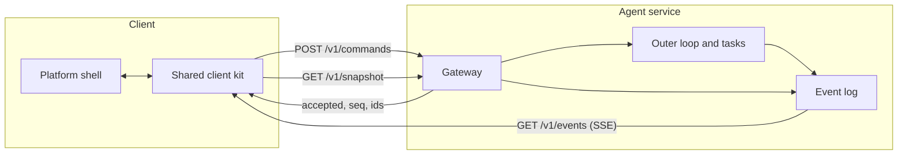
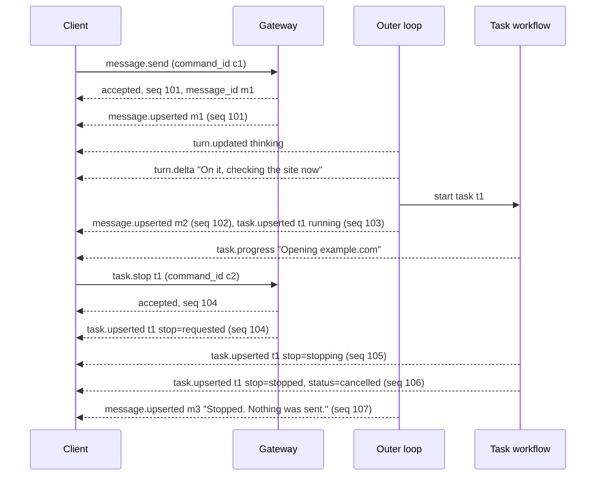
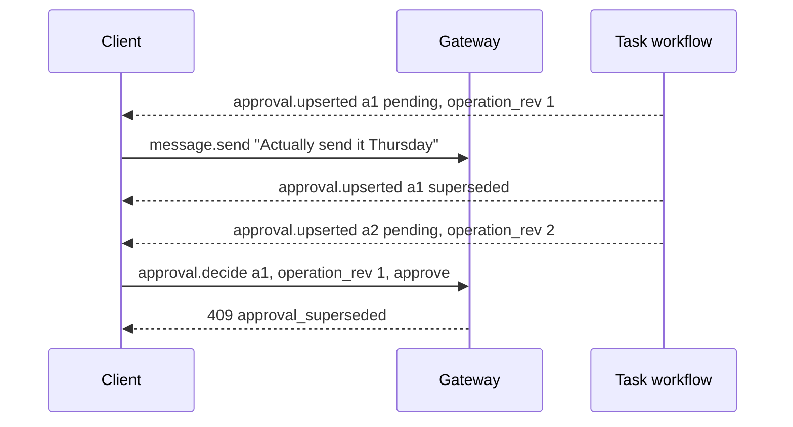

# Nori client contract

| | |
| --- | --- |
| Status | Proposal, in review. [Implemented today](#implemented-today) lists what runs. |
| Last updated | 2026-11-01 |
| Scope | The protocol between Nori's agent service and every client app (web, desktop, mobile) |
| Related | [Separation of concerns](separation-of-concerns.md); architecture, outer loop and inner loop (ChatGPT Spaces); Linear AB-120, AB-122, AB-130, AB-131, AB-133 |

The key words MUST, MUST NOT, SHOULD, SHOULD NOT and MAY are used as described in RFC 2119.

## Implemented today

Most of this document is a proposal. Sections 1 and 3 to 15 describe a `/v1` gateway, an event log and a live stream, and none of that is built. The running system is smaller.

| | Implemented today | Proposed in this document |
| --- | --- | --- |
| Clients | One, the web app. | Web, desktop and mobile. |
| Calls | The browser sends `POST /api/<operation>` to its own Next.js server, which forwards to the Go API. The operations are `session`, `status`, `turn`, `command`, `artifact` and `trace`. `input` and `cancel` exist, but the client doesn't call them. | `POST /v1/commands`, `GET /v1/snapshot` and an event stream (§7.5). |
| Updates | Polling with a version check. See below. | Server-sent events with replay (§7.6). |
| Sign-in | Google IAP in front of Cloud Run. The web server verifies IAP's signed assertion and accepts one owner. It calls the runtime with its own service account's access token. | Identity Platform with ID tokens verified at the gateway (§7.1, D7). |
| Browser storage | `sessionStorage` holds unsent messages, unsent task commands and reply timings. The service holds every other record. | A projection cache (§13, phase 1). |
| Not built | | Event log, typed message parts, approvals, device registry, read cursors, notification policy. |

### Polling with a version check

The client polls because the runtime scales to zero. An open event stream holds one request open for as long as a tab is open, which keeps an instance running. Polling asks only while work is active. The client doesn't poll when nothing is running or the tab is hidden.

While work is active, the client calls `POST /api/status` every 2 seconds. The reply is `{"version": "<opaque string>", "busy": <bool>}`. The client fetches the whole session when:

- it loads the page, or after one of its own actions,
- `version` differs from the last one it saw,
- the `status` call fails, or `busy` is false while the client still shows active work.

If `status` is missing, or fails three times in a row, the client polls the session every 2 seconds, as it did before `status` existed. `version` is only compared for equality. The runtime changes it whenever the paused flag, the conversation, the active turn or an open task changes. A finished task's late spend projection does not change `version`. It appears at the next change, or at the final fetch the client makes when `busy` turns false. Model usage records written outside a turn behave the same way.

## 1. Summary

Nori will have several clients on different platforms and one agent service. This document specifies the single contract all of them share. Clients send **commands**, which state the owner's intent. The service answers each command with a **durable acknowledgment**, never with a result. The service publishes everything that changes as an **ordered, replayable event log**, and adds a **live stream** of ephemeral events (typing, reply text as it is written, tool progress). A client builds its view from a **snapshot** and then follows the log from the snapshot's position. The service owns conversation state, context, tasks, approvals, effects, memory and notification policy. Clients own rendering, input, offline queuing and platform integration.

## 2. Background

### 2.1 Current state

- **Earlier web demo (removed).** The browser was the backend. Every domain record lived in the browser's localStorage. The browser built the prompt and the system context on every turn, and a Next.js route streamed raw text from the model. The browser then parsed chips, approvals, artifacts and reactions out of HTML-comment hints in that text and minted IDs for objects the agent created. A second device or a second browser couldn't share any of this state. The current web app keeps no domain records, only unsent messages in `sessionStorage`.
- **Current app (on `main`).** The Go API serves `POST /api/session`, `turn`, `command`, `status`, `artifact` and `trace`. The first request that held the HTTP connection open for a whole run (`/api/run`) is gone: `turn` is acknowledged once the message is saved, and tasks run as Temporal workflows. A Next.js server proxies every call with its service account's token, behind IAP, and the client polls as described in [Implemented today](#implemented-today).
- **Agreed agent architecture (outer and inner loop docs).** The outer loop answers each input with a short turn that responds, dispatches, updates a dispatch or clarifies. Independent tasks run as one Temporal Cloud workflow each, and Firestore holds the application records. "The outer loop waits for durable command acceptance, not task completion." Routine tool activity may stream straight to the interface, while results and requests for input come back through the conversation.

### 2.2 Problem

Neither existing interface can support more than one client or the agreed agent architecture:

1. State that lives on one client can't be shared with another.
2. A request/response run ties up a connection for the whole task, allows only one task at a time, and loses progress when the connection drops.
3. Clients that build prompts or parse model output each have to reimplement agent behavior, and they drift apart.
4. Approvals that come from free chat text aren't tied to the exact operation they authorize (AB-133).

## 3. Goals

1. One contract for every client: no per-platform endpoints and no client-specific behavior in the service.
2. Every connected device agrees on conversation, task, approval and effect state within about a second.
3. A command is acknowledged once it is durably accepted, independent of how long the work takes.
4. The client view survives reconnects, reloads, process death and offline periods without loss or duplication.
5. Show the honest state of work: acknowledged, applied, stopping, stopped, and prepared, attempted, submitted, confirmed or uncertain.
6. Clients never see prompts, tool credentials or model-output conventions.
7. Additive evolution: old clients keep working as the service gains features.

## 4. Non-goals

- Multiple owners. Nori has one owner. Identifiers are scoped by owner so that more can be added later.
- Voice input and output. Out of scope until it returns to the roadmap.
- Internal service design: Jev questions, model choice, Temporal workflow structure, context budgets. This contract only fixes what clients observe.
- Ideas, Goals and Upcoming (schedules) as service-owned resources. These follow in phase 4 (§13).
- Clients editing or replaying agent internals such as task briefs, worker transcripts or tool schemas.
- Real-time collaboration between different people.

## 5. Requirements

### 5.1 Functional

| ID | Requirement |
| --- | --- |
| F1 | A client can send a message with text, images and Library attachments to the main thread or a side thread. |
| F2 | A client sees Nori's reply as it is written, then as a final structured message. |
| F3 | A client sees tasks that Nori dispatched, their status, what they are waiting for and their outcome. |
| F4 | A client can stop a specific task and see Stop move from requested to stopped, or to "not applied" if the task already finished. |
| F5 | A client can approve or decline a pending operation. A decision against a superseded operation is rejected. |
| F6 | A client can see each external effect's state, including uncertain ones. |
| F7 | A client can read and edit Nori's soul and memory documents, with conflict detection. |
| F8 | A client can change settings (proactive messaging, quiet hours, daily cap, time zone). The service enforces them. |
| F9 | The service can notify the owner on any registered device, and reading on one device clears the badge on the others. |
| F10 | A client can page back through older thread history. |

### 5.2 Non-functional

| ID | Requirement |
| --- | --- |
| N1 | Every command is idempotent under client retry. |
| N2 | Events are delivered at least once, and applying them is idempotent and ordered. |
| N3 | A client that was offline for up to 30 days can catch up from its cursor without a full reload. |
| N4 | Proposed latency targets, to be validated in phase 1: command acceptance p95 ≤ 300 ms; durable event fan-out to connected clients p95 ≤ 1 s; a `thinking` signal within 1 s of acceptance. |
| N5 | The contract is versioned. Within a major version, changes are additive only. |
| N6 | Only the owner's authenticated devices can read or write. |

## 6. Design overview

### 6.1 Ownership

**If two clients could disagree about something, the service owns it.** Clients own only how that state looks and feels on their own platform. [Separation of concerns](separation-of-concerns.md) covers this split in detail.

### 6.2 Interaction model

1. **Bootstrap.** The client fetches a bounded snapshot, which carries `seq`, the log position it reflects.
2. **Follow.** The client opens the event stream after that `seq`. Durable events update its local projection. Ephemeral events drive presence and live text.
3. **Act.** The client sends commands. Each one is accepted (durably recorded) or rejected synchronously. Its effects arrive later as events, like everything else.

## 7. Detailed design

### 7.1 Identity, devices and authentication

- A **device** is one installed client instance, identified by a client-generated, stable `device_id` (a UUID) that it registers with `device.register`.
- **Proposal, not built.** Clients authenticate to the gateway with a bearer ID token for the owner's Google account. The proposal is Identity Platform with the Google provider, which works the same way in browsers, desktop apps and mobile apps (decision D7). Today the web app uses Google IAP and one owner. See [Implemented today](#implemented-today).
- The gateway MUST verify the token's signature, issuer, audience and expiry, and MUST check the subject against the owner allowlist. Every request MUST carry `Nori-Device-Id`.
- The web app calls the gateway directly, with a CORS allowlist for its own origin. The Next.js server no longer proxies agent calls with a service-account token. IAP MAY still protect the hosting of the web shell itself.
- Device revocation (sign-out everywhere, per-device removal) is out of scope for v1. The device registry makes it possible later.

### 7.2 Resource model

Every resource has a stable `id` (UUIDv7, assigned by the service unless noted) and a `rev`, an integer that increases on every change. Timestamps are RFC 3339 UTC.

**Thread**

| Field | Type | Notes |
| --- | --- | --- |
| `id` | id | The main thread has a well-known ID, `main`. |
| `kind` | `main` \| `side` | |
| `title` | string | |
| `created_at`, `updated_at` | timestamp | |
| `last_message_at` | timestamp | |

**Message**

| Field | Type | Notes |
| --- | --- | --- |
| `id`, `rev` | | |
| `thread_id` | id | |
| `sender` | `owner` \| `nori` | |
| `parts` | Part[] | See §7.9. |
| `preview_text` | string | Plain-text summary for lists, notifications and old clients. |
| `reply_to` | id? | The message this one quotes. |
| `from_chip` | `{message_id, chip_id}`? | The owner sent this by tapping a chip. |
| `supersedes` | id? | Set when the owner edited an earlier message (§7.3, D3). |
| `superseded_by` | id? | Set on the original message once it is edited. |
| `reactions` | `{emoji, by}`[] | At most one per sender. |
| `turn_id` | id? | Set on Nori's messages: the outer turn that produced it. |
| `task_id` | id? | Set when the message reports a task's outcome or asks for its input. |
| `proactive` | bool | Nori wrote first. Counts toward the daily cap. |
| `client_command_id` | id? | Set on the owner's messages, for reconciling optimistic UI. |
| `created_at` | timestamp | When the service accepted the message. |

**Task** (a client-facing projection. Temporal owns execution, and this is a view of it.)

| Field | Type | Notes |
| --- | --- | --- |
| `id`, `rev` | | |
| `title` | string | Short verb phrase. |
| `category` | string | A descriptor for display (`lookup`, `research`, `create`, `modify`, `communicate`, `monitor`, …). Clients MUST NOT tie behavior to it. |
| `origin_thread_id` | id | Outcomes are delivered here (D2). |
| `status` | enum | `running`, `waiting`, `needs_input`, `blocked`, `completed`, `failed`, `cancelled`. |
| `waiting_for` | enum? | `input`, `approval`, `time`, `dependency`. Present only while `waiting` or `needs_input`. |
| `resume_at` | timestamp? | Set when `waiting_for = time`. |
| `stop` | enum | `none`, `requested`, `stopping`, `stopped`, `not_applied`. |
| `instruction_rev` | int | The accepted instruction revision the task is working from. |
| `follows_task_id` | id? | Follow-up work linked to an earlier task. |
| `result` | `{summary, message_id, artifact_ids[]}`? | Present only when the result is verified against the latest instructions. |
| `created_at`, `updated_at`, `finished_at` | timestamp | |

**Approval**

| Field | Type | Notes |
| --- | --- | --- |
| `id`, `rev` | | |
| `task_id` | id | |
| `operation_id` | id | The exact operation this decision authorizes. |
| `operation_rev` | int | The revision of the operation's arguments. Any change invalidates the approval. |
| `title` | string | Verb phrase: "Send a message to the seller". |
| `what`, `why`, `impact` | string | |
| `status` | enum | `pending`, `approved`, `declined`, `superseded`, `expired`. |
| `expires_at` | timestamp? | |
| `decided_at`, `decided_by_device` | | |

**Operation** (an external effect or a write)

| Field | Type | Notes |
| --- | --- | --- |
| `id`, `rev` | | A stable operation ID, also used as the provider idempotency key. |
| `task_id` | id | |
| `label` | string | "Send email to Sam". |
| `state` | enum | `prepared`, `attempted`, `submitted`, `confirmed`, `failed`, `uncertain`. |
| `receipt` | `{summary, artifact_id?}`? | The evidence behind the state. |

**Activity entry**: an append-only, service-written timeline record: `id`, `at`, `type` (`done`, `web`, `memory`, `drafted`, `notified`; open-ended), `title`, `summary`, `task_id?`, `thread_id?`, `message_id?`.

**Artifact**: `id`, `rev`, `title`, `type` (`document`, `page`, `dashboard`, `image`, `audio`, `file`), `made_by` (`nori` \| `owner`), `created_at`, `size_bytes`, `thumb` hint, and `body` (markdown, inline only when ≤ 64 KiB). Binary content is fetched separately (§7.5).

**Identity documents**: `soul` and `memory`, each with `content`, `rev`, `updated_at`, `updated_by` (`owner` \| `nori`) and a bounded `history` of revisions, each with a note.

**Settings**: `proactive`, `quiet_start`, `quiet_end`, `daily_cap`, `time_zone`, `name`, `look`.

**Read cursor**: per thread, the latest `seq` the owner has read on any device.

### 7.3 Commands

All writes go through `POST /v1/commands`, which carries a single envelope:

| Field | Required | Notes |
| --- | --- | --- |
| `command_id` | yes | Client-generated UUIDv7. The idempotency key. |
| `type` | yes | See the table below. |
| `payload` | yes | Depends on the type. |
| `issued_at` | yes | The client's clock, recorded for display only. The service orders by acceptance. |

Command types in v1:

| Type | Payload | Effect once accepted |
| --- | --- | --- |
| `message.send` | `thread_id`, `parts[]`, `reply_to?`, `from_chip?` | Records the owner's message and puts it in the outer loop's inbox. |
| `message.edit` | `message_id`, `parts[]` | Records a new message with `supersedes`. The outer loop treats it as a correction. |
| `message.react` | `message_id`, `emoji` \| `null` | Sets or clears the owner's reaction. Doesn't start a turn. |
| `thread.create` | `title?` | Creates a side thread. |
| `thread.rename` | `thread_id`, `title` | |
| `thread.mark_read` | `thread_id`, `through_seq` | Advances the read cursor and clears badges on other devices. |
| `task.stop` | `task_id` | Sets `stop = requested`. Skips classification. |
| `approval.decide` | `approval_id`, `operation_rev`, `decision` (`approve` \| `decline`) | Records the decision and signals the task. Skips classification. |
| `doc.update` | `doc` (`soul` \| `memory`), `base_rev`, `content`, `note` | Optimistic-concurrency write. |
| `settings.update` | partial settings | |
| `device.register` | `platform`, `app_version`, `push_token?` | Creates or refreshes the device record. |

Semantics:

- **Accepted means durable.** A 200 response means the command and its delivery intent are committed in Firestore. It never means the work is done. The response body is `{status: "accepted", seq, ids}`, where `seq` is the log position of the command's first event and `ids` holds any IDs the service assigned (such as `message_id`).
- **Idempotency.** For at least 7 days, a repeated `command_id` returns the original response unchanged and has no further effect. Reusing a `command_id` with a different payload is rejected with `idempotency_mismatch`.
- **Validation.** The gateway checks shape, size and the target's existence and state synchronously. Interpretation (what a message means, which task it steers) is the outer loop's job and never blocks acceptance.
- **Explicit controls.** `task.stop` and `approval.decide` target an exact resource and skip Jev and the conversational model, as the outer-loop doc requires. A natural-language "stop the research" goes through `message.send` and is interpreted there.
- **Acknowledged versus applied.** Accepting `task.stop` sets `stop = requested`. Later events move the task to `stopping`, then to `stopped` with `status = cancelled`. If the task finished first, it moves to `not_applied`. Clients MUST present these as distinct states.
- **No client-authored context.** Commands carry only the owner's own content and references. Clients MUST NOT send system context, prompt fragments or summaries.

### 7.4 Events

Every event has an envelope:

| Field | Notes |
| --- | --- |
| `seq` | Present on durable events only. Strictly increasing per owner, but not necessarily contiguous. |
| `type` | `noun.verb` in the past tense or `noun.upserted`. |
| `at` | When the service emitted the event. |
| `cause` | `{command_id?, turn_id?, task_id?}` for correlation. |
| `data` | Depends on the type. |

**Durable events** carry the full current state of one resource. Clients apply them as an upsert by `id`, keeping the copy with the higher `rev`. That makes applying them idempotent and safe to replay.

| Type | Data |
| --- | --- |
| `thread.upserted` | Thread |
| `message.upserted` | Message (new, edited, superseded, reaction or chip choice changed) |
| `task.upserted` | Task |
| `approval.upserted` | Approval |
| `operation.upserted` | Operation |
| `activity.appended` | Activity entry |
| `artifact.upserted` | Artifact metadata |
| `doc.upserted` | Identity document |
| `settings.upserted` | Settings |
| `read_cursor.updated` | `{thread_id, through_seq}` |

**Ephemeral events** carry no `seq`, are never stored in the log, and are lost if the client isn't connected.

| Type | Data | Meaning |
| --- | --- | --- |
| `presence.snapshot` | active turns (with their draft text so far), running task progress | The first event on every new stream connection, so a device that joins mid-reply sees the draft. |
| `turn.updated` | `turn_id`, `thread_id`, `phase`, `cause_message_ids[]` | `phase` is `thinking`, `writing`, `done`, `superseded` or `failed`. |
| `turn.delta` | `turn_id`, `offset`, `text` | Reply text appended at a character offset. Clients drop deltas whose offset they already have. |
| `task.progress` | `task_id`, `label`, `fraction?` | Routine tool activity, such as "Opening example.com". |
| `heartbeat` | none | Sent every 15 s. |
| `resync_required` | `reason` | The client's cursor can't be served. It must fetch a fresh snapshot. |

Clients MUST ignore unknown event types and unknown fields.

### 7.5 Read API

| Endpoint | Purpose |
| --- | --- |
| `GET /v1/snapshot` | A bounded projection: all threads; the latest 50 messages per thread; tasks that are open or finished in the last 7 days; pending approvals; the latest 50 activity entries; the latest 50 artifacts (metadata only); identity documents; settings; read cursors; and `seq`, the log position the snapshot reflects. |
| `GET /v1/events?after={seq}` | A `text/event-stream`. Durable events set the SSE `id` field to their `seq`. The stream honors `Last-Event-ID`. |
| `GET /v1/events/page?after={seq}&limit={n}&wait={s}` | A JSON page of durable events, for catch-up, and a long-poll fallback where streaming isn't available. At most 500 events per page and a 25 s wait. |
| `GET /v1/threads/{id}/messages?before={message_id}&limit={n}` | Older history. |
| `GET /v1/tasks/{id}` | Task detail with its operations, approvals and activity. |
| `GET /v1/artifacts/{id}` | Metadata plus a signed content URL that expires in 5 minutes. |
| `POST /v1/uploads` | Returns a signed upload URL and an `artifact_id`. Images and files are uploaded first, then referenced from `message.send`. They are never sent inline as base64. |

### 7.6 Ordering, delivery and consistency

- **One log per owner (D1).** All durable events share one sequence. Tasks and approvals cross threads, and badge counts are global.
- **Snapshot consistency.** A snapshot at `seq = N` reflects exactly the durable events up to and including N. The client then streams from `after = N`.
- **Delivery.** At least once, in `seq` order on any one connection. Clients MUST track the highest applied `seq` and ignore events at or below it.
- **Retention.** Durable events are kept for at least 30 days. A cursor older than that gets `resync_required` on the stream, or `410 Gone` from the page endpoint.
- **Read-your-writes.** A command's response `seq` lets the client hold its optimistic state until the stream reaches that `seq`. A durable event whose `cause.command_id` matches the optimistic entry replaces it.
- **Clocks.** Display ordering uses service timestamps. `issued_at` is informational.

### 7.7 Turn lifecycle as clients see it

1. `message.send` is accepted. Then come `message.upserted` (the owner's message) and `turn.updated {phase: thinking}`.
2. As the reply streams, `turn.updated {phase: writing}` arrives, followed by `turn.delta`s. A client MAY pace the reveal, as the web revealer does today.
3. To publish, the service emits `message.upserted` (Nori's final message, with typed parts and `turn_id`) and then `turn.updated {phase: done}`. If the turn dispatched or updated work, `task.upserted` events follow with the same `cause.turn_id`.
4. If newer input arrives before publication, the service MAY supersede the turn. It then emits `turn.updated {phase: superseded}`, and clients MUST discard that turn's draft. A new turn follows.
5. If the turn fails, `turn.updated {phase: failed}` arrives with a short, owner-safe reason. The owner retries by sending again. There is no retry command, because retrying is just a new turn.

Clients never cancel a turn. A newer message is enough: the outer loop decides whether to supersede the turn in flight. This replaces today's client-side abort on send.

### 7.8 Tasks, Stop and approvals

- A task's outcome is delivered as a Nori message in `origin_thread_id`, with `task_id` set, plus an activity entry (D2). Unrelated open tasks are unaffected.
- `result` appears only when the result was verified against the current `instruction_rev`. The service never publishes a superseded result. If a correction arrives after publication, the service starts a follow-up task with `follows_task_id`.
- An approval is created only at operation admission inside a task, bound to `operation_id` and `operation_rev`. The conversational model can't create approvals from chat text.
- `approval.decide` with a stale `operation_rev`, or against a status other than `pending`, is rejected with `approval_superseded` or `approval_closed`. Clients then show the current approval state.
- Clients MUST NOT post a message on the owner's behalf to record a decision. The decision is the command, and any reply from Nori arrives as an ordinary message.
- Clients MUST present operation states as distinct. `uncertain` MUST NOT be shown as success.

### 7.9 Message parts

Nori's messages carry typed parts that the service produces. Clients MUST NOT parse model-output conventions.

| Part | Fields | Rendering |
| --- | --- | --- |
| `text` | `markdown`, `presentation` (`auto` \| `bubble` \| `page`) | `auto` means the client applies its bubble-or-page rule. |
| `chips` | `options[{id, label}]`, `chosen_id?` | Tapping one sends `message.send` with `from_chip`. At most 4 options. |
| `image` | `artifact_id`, `alt`, `width`, `height` | |
| `artifact` | `artifact_id` | Cover bubble plus a Library tile. |
| `approval` | `approval_id` | Rendered from the approval resource, not from the part. |
| `attachment` | `artifact_id` | The owner attached this Library item or upload. |

Every part other than `text` carries `fallback_text`. A client that doesn't recognize a part type MUST render its `fallback_text`.

The owner's messages may contain `text`, `image` (an upload reference) and `attachment` parts. Limits: 16 KiB of text per message, 10 parts, 20 MB per upload.

### 7.10 Notifications

- The service decides whether a durable change deserves the owner's attention, applying `proactive`, quiet hours and the daily cap. It records the decision as `notify: {level: alert | badge | silent, reason}` on the related `message.upserted`.
- The service delivers alerts through FCM (which also reaches APNs) to registered devices. It SHOULD skip devices that currently hold an open event stream.
- Read cursors are the only source for badges. Reading on one device sends `read_cursor.updated`, which clears the badge on the others.

### 7.11 Errors

Errors use HTTP status codes plus a stable machine-readable code: `{error: {code, message, retryable}}`. `message` is safe to show the owner.

| HTTP | Code | When |
| --- | --- | --- |
| 400 | `invalid_command` | Bad shape, unknown command type, or size limits exceeded. |
| 401 | `unauthenticated` | Missing or invalid token. |
| 403 | `forbidden` | Not the owner, or the device isn't registered. |
| 403 | `paused` | The service is paused (the project pause control). |
| 404 | `unknown_target` | The referenced thread, message, task or approval doesn't exist. |
| 409 | `conflict` | `base_rev` is stale on `doc.update`. |
| 409 | `approval_superseded`, `approval_closed` | See §7.8. |
| 409 | `idempotency_mismatch` | The `command_id` was reused with a different payload. |
| 410 | `cursor_expired` | The page endpoint's cursor is older than retention. |
| 429 | `rate_limited` | More than 60 commands per minute per device. |
| 503 | `unavailable` | Retryable. The client keeps the command in its outbox. |

### 7.12 Versioning and compatibility

- All paths are under `/v1`. Within v1, the service only adds: new command types, new event types, new optional fields, new part types (each with `fallback_text`) and new enum values.
- Clients MUST ignore unknown fields and event types and MUST tolerate unknown enum values by showing a neutral state.
- Clients send `Nori-Client: <platform>/<version>`. The snapshot carries `min_client_version` per platform, and a client below it MUST prompt for an update.
- A breaking change requires `/v2`, served alongside `/v1` until every registered device has moved over.

## 8. Client responsibilities

A shared client kit implements these the same way on every platform. Where possible it is one TypeScript package used by web, desktop and React Native.

1. **Projection cache.** Apply the snapshot and events, persist them locally, and show stale data honestly while offline.
2. **Outbox.** Persist commands with their `command_id`, send them in order, retry with backoff on `503` or network failure, and drop them on terminal `4xx` with a visible error.
3. **Optimistic UI.** Render the owner's own messages immediately, then reconcile them by `client_command_id`.
4. **Stream management.** Reconnect with `Last-Event-ID`, fall back to the page endpoint, and handle `resync_required`.
5. **Rendering rules.** The bubble-or-page rule for `presentation = auto`, paced reveal of `turn.delta` text, and `fallback_text` for unknown parts.
6. **Presence.** Derive the avatar's modes from events, following the avatar state protocol: `turn.updated` drives thinking and speaking, open tasks and `task.progress` drive working, pending approvals and `needs_input` drive waiting, and a lost stream drives trouble. Each claim is keyed by `turn_id` or `task_id`, with a TTL.

Platform shells own navigation, layout, input methods, OS integrations (push display, share sheet, widgets, menu bar), and per-device UI state such as drafts, open panels and the active thread.

## 9. Security and privacy

- Only the owner's verified identity can call the gateway (§7.1). No endpoint is anonymous apart from `/healthz`.
- Clients never receive prompts, system context, tool schemas, provider credentials or worker transcripts.
- Content from clients is treated as the owner's content: data for the model, never instructions to the service.
- Artifact content is served only through short-lived signed URLs. Uploads go to a quarantined prefix until the service validates their type and size.
- TLS everywhere. CORS is limited to the web app's origins.
- Rate limits and size limits (§7.9, §7.11) cap runaway clients.
- The local caches on clients hold personal data. Clients SHOULD use platform-protected storage and MUST clear it on sign-out.

## 10. Performance and limits

| Item | Value |
| --- | --- |
| Command acceptance | p95 ≤ 300 ms (target) |
| Durable event fan-out to connected clients | p95 ≤ 1 s (target) |
| `thinking` after acceptance | ≤ 1 s (target) |
| Snapshot size | Bounded by §7.5. Target ≤ 1 MB compressed. |
| Stream heartbeat | 15 s |
| Idempotency window | 7 days |
| Event retention | 30 days |
| Command rate | 60 per minute per device |

The targets are proposals. Phase 1 measures them on the real Cloud Run deployment before they become commitments.

## 11. Observability

- Every command, event, turn and task carries correlation IDs (`command_id`, `turn_id`, `task_id`, `operation_id`). Clients send a W3C `traceparent`, which the service propagates into Temporal.
- Service metrics: acceptance latency, fan-out latency, open streams, reconnects, `resync_required` count, duplicate-command rate, superseded turns, rejected decisions, and time spent in each Stop state.
- Client logs record the cursor `seq` at each reconnect, so a gap can be traced to a specific point.

## 12. Alternatives considered

1. **Keep the request/response run API (the earlier POC).** Rejected. It ties up a connection for the whole task, allows one task at a time, can't sync devices, and contradicts "wait for durable acceptance, not completion".
2. **Clients read Firestore directly (Firebase SDK listeners).** This would give realtime sync and offline support for free. Rejected for v1: the storage schema and security rules would become the contract, which couples every client to internal records, makes versioning hard, and has no channel for ephemeral reply text. It is worth revisiting for mobile offline support behind the same resource shapes.
3. **WebSockets.** Rejected for v1. Commands already go over plain POST, so the stream only needs one direction. SSE gets standard resumption (`Last-Event-ID`), works through ordinary HTTP infrastructure, and has mature client libraries on every target platform. WebSockets can be reconsidered if voice or other bidirectional realtime returns.
4. **One stream per thread.** Rejected. Tasks, approvals and badges span threads, and per-thread streams multiply connections on mobile.
5. **Resource-style REST mutations (`POST /messages`, `POST /tasks/{id}/stop`).** Rejected in favor of one command endpoint. A single envelope gives uniform idempotency, ordering and outbox handling. Reads stay resource-oriented.
6. **Clients parse model output (the status quo).** Rejected. Every client would reimplement agent conventions, and approvals couldn't be bound to operations.
7. **Delta events in the durable log.** Rejected. They would multiply writes by about a hundred per reply for text that is replaced by the final message within seconds.

## 13. Rollout plan

| Phase | Scope | Exit criteria |
| --- | --- | --- |
| 1. Contract on today's loop | The gateway in core (Go): commands, snapshot, events and SSE, backed by Firestore. Replies come from one outer-loop turn, ported from today's web route into Go, and the server produces the typed parts. The web app moves its `NoriBackend` seam onto the shared kit, and localStorage becomes the projection cache. Ideas, Goals and Upcoming stay on seed data. | Two browsers stay in sync. Reloading mid-reply recovers the draft. A repeated send is deduplicated. The N4 targets are measured. |
| 2. Tasks | `dispatch` and `update_dispatch` start Temporal workflows. Task, approval and operation events and the Stop states are wired up. The POC endpoints are retired (D5). | One real task goes through a worker restart, a queued correction, a durable wait and a confirmed cancellation, and the UI shows each state. A superseded approval is rejected. |
| 3. Second client | The shared kit becomes its own package. A desktop or mobile shell is built on it. Push, read cursors and device registration. | One conversation is used on two platforms, with badges clearing across devices. |
| 4. Remaining resources | Ideas, Goals and Upcoming become service-owned, with their own commands and events. | No client seed data remains. |

Each phase is independently useful. Phase 1 replaces the demo's in-browser backend even before any task work lands.

## 14. Decisions requested in review

| ID | Decision | Proposal |
| --- | --- | --- |
| D1 | Stream scope | One log and one stream per owner. |
| D2 | Where task outcomes land | In the task's origin thread, plus an activity entry. |
| D3 | Editing a sent message | A new message with `supersedes`, treated as a correction. History isn't rewritten. |
| D4 | Ideas, Goals, Upcoming | Stay client seed data until phase 4. |
| D5 | The POC run API | A `Run` becomes the first `Task`. `/run` maps to `message.send` plus events, and `/cancel` maps to `task.stop`. Retired in phase 2. |
| D6 | Transport | SSE from Cloud Run, with the JSON page endpoint as the long-poll fallback. |
| D7 | Client authentication | Identity Platform with Google sign-in, with ID tokens verified at the gateway. |
| D8 | Write surface | One `POST /v1/commands` endpoint. |

## 15. Open questions

1. Does the gateway run in the same Go binary and Cloud Run service as the outer loop, or as its own service? The proposal is the same binary with separate roles. The answer decides how `turn.delta` reaches the gateway (in process or through Pub/Sub).
2. Should drafts sync across devices? Not in v1. Per-device drafts are a shell concern.
3. May chips stream before the final message, or only arrive with it? The proposal is final message only.
4. Device revocation and sign-out everywhere. When does that become necessary?
5. How long are the idempotency window and retention, given Firestore cost? Measure in phase 1.

## Appendix A. Mapping from current code

This table maps the earlier web demo. The `web/src/lib/nori/*` files and `store.ts` it names were removed, and the rows describe where each job was meant to go.

| Today | Under this contract |
| --- | --- |
| `web/src/lib/nori/backend.ts` `NoriBackend.reply` | Shared kit: `POST /v1/commands`, `GET /v1/snapshot`, `GET /v1/events`. |
| `web/src/lib/nori/engine.ts` `toApiMessages`, `buildContext` | Removed from clients. The service assembles context. |
| `web/src/lib/hybrid.ts` `extractHints`, `engine.ts` `finalize` | Typed parts produced by the service. The client keeps only the bubble-or-page rendering rule. |
| `engine.ts` `resolveApproval` and its `[I tapped Approve…]` nudge | `approval.decide`. |
| `engine.ts` `liveReply` aborting on a new send, `cancelAll` | No client abort. Turns are superseded by the service. `task.stop` stops tasks. |
| `engine.ts` `canMessageFirst`, `inQuietHours` | Service notification policy (§7.10). |
| `web/src/lib/store.ts` `persist` of domain state | Projection cache built from the snapshot and events. UI state stays local. |
| Store fields `typing`, `work`, `stream`, `markState` | Derived from `turn.updated`, `turn.delta`, `task.upserted`, `task.progress` and approvals. |
| POC `/api/session`, `/api/run`, `/api/cancel`, `/api/artifact` | `/v1/snapshot`, `message.send`, `task.stop`, `/v1/artifacts/{id}`. |
| `web/src/app/api/nori/route.ts` (spends the API key, localhost only) | Retired in phase 1. Model calls happen only in the service. |

## Appendix B. Example sequences

### B.1 A message that dispatches a task, followed by Stop

### B.2 A superseded approval

