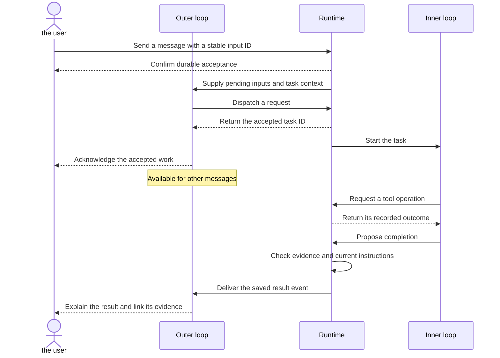
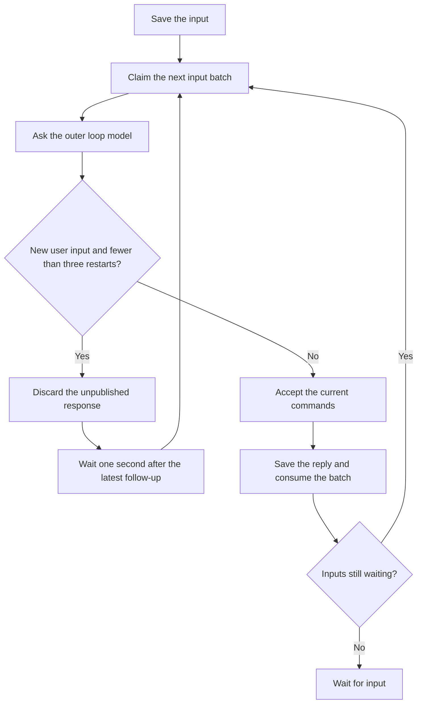
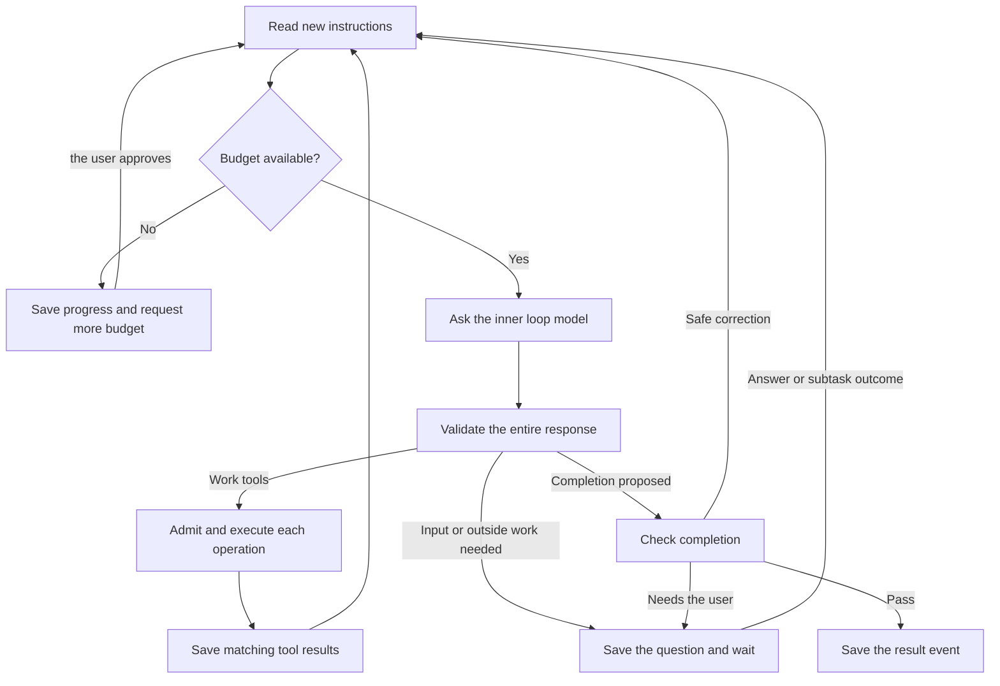
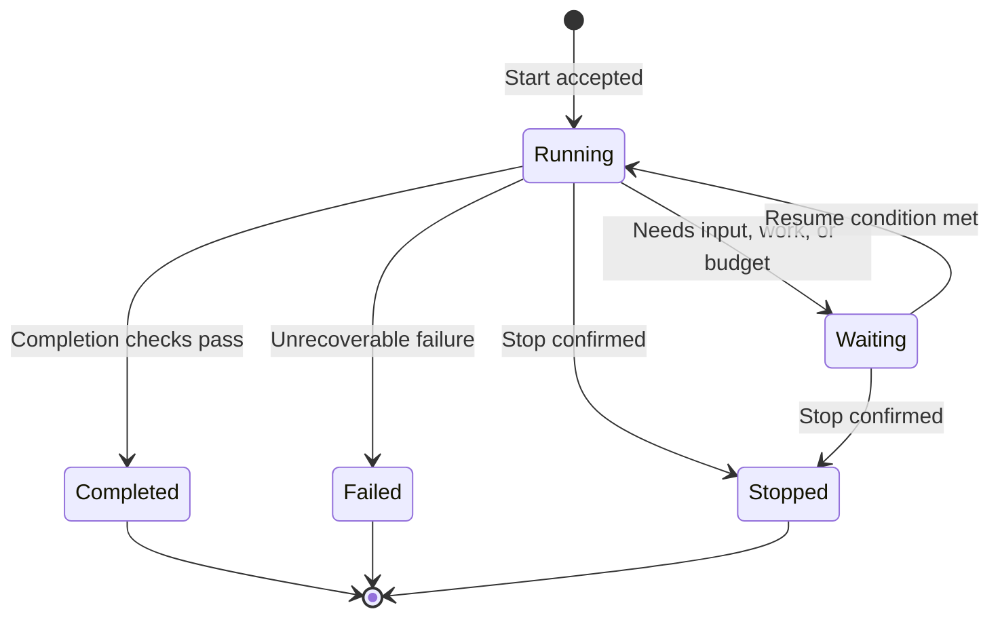
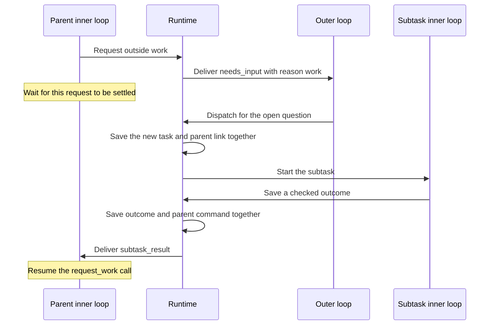
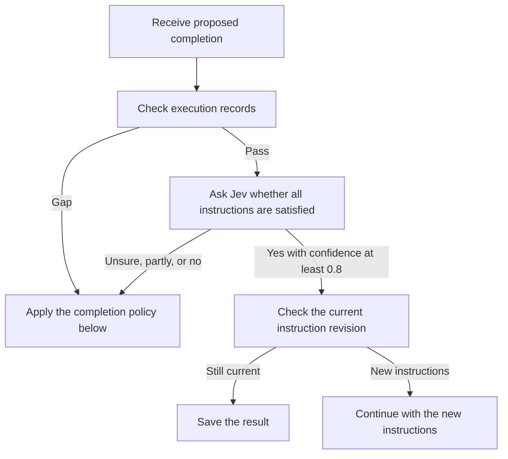
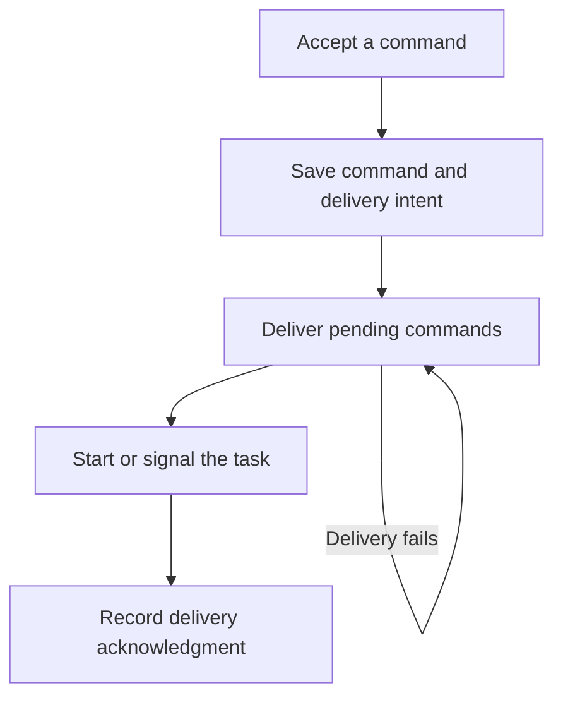
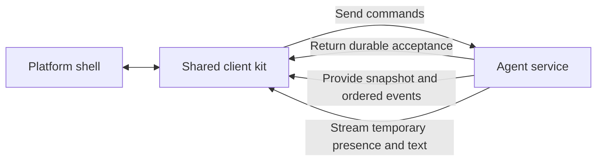
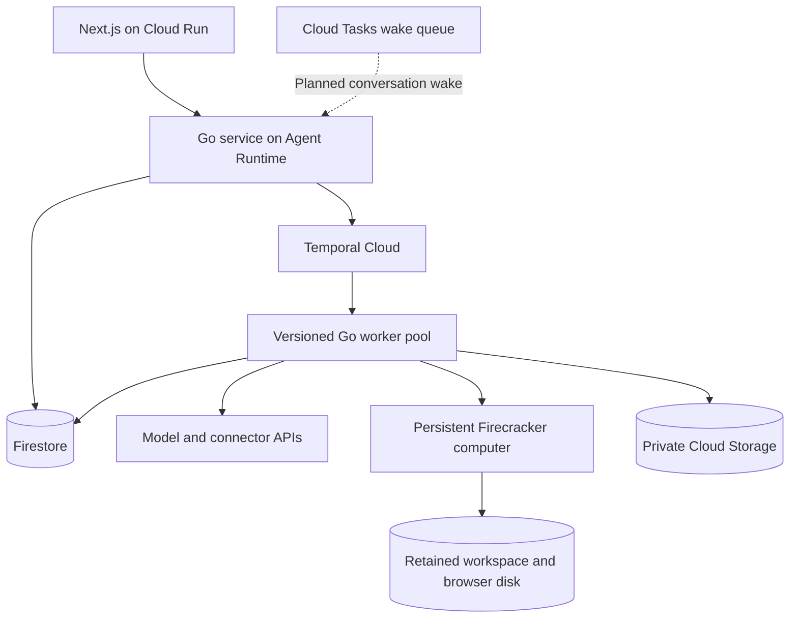

# Nori design

> Snapshot from October 26, 2026, kept for reference and no longer maintained. Its implementation baseline is out of date. The current documentation is in `docs/site/`. Its links to Spaces pages no longer work.

Nori is a personal assistant that keeps a conversation available while carrying work through to a useful result. the user can ask a question, delegate another task, correct work already underway, answer a question later, or return after closing the app. Nori keeps the instructions, progress, and results connected across those interactions.

**One outer loop coordinates independent inner loops.** The outer loop understands the conversation and routes work. Each inner loop owns one task. The runtime preserves state, enforces authority and budgets, and checks effects before reporting completion. Keep the existing Go service, Firestore records, Temporal Cloud task workflows, and persistent computer; extend them in useful increments.

The immediate implementation focus is a durable conversational home: accepted messages survive restarts, rapid follow-ups produce a current answer, and debug shows recorded execution. Concurrent task coordination follows that foundation. The complete client synchronization protocol, memory, additional capabilities, and proactive assistance have their own delivery stages.

This document describes the agreed design, identifies proposals where choices remain open, and records the implementation baseline separately. Source coverage and resolved conflicts are in [Sources and reconciliation](#sources-and-reconciliation). Diagrams use Mermaid and are embedded in this file.

## Contents

- [Product experience](#product-experience)
- [Architecture and ownership](#architecture-and-ownership)
- [A request from start to finish](#a-request-from-start-to-finish)
- [The outer loop](#the-outer-loop)
- [The inner loop](#the-inner-loop)
- [Commands events and task identity](#commands-events-and-task-identity)
- [Steering waiting and Stop](#steering-waiting-and-stop)
- [Subtasks and held questions](#subtasks-and-held-questions)
- [Tool outcomes and completion](#tool-outcomes-and-completion)
- [Budgets and execution controls](#budgets-and-execution-controls)
- [Durable records and recovery](#durable-records-and-recovery)
- [Clients and the user interface](#clients-and-the-user-interface)
- [Context memory and capabilities](#context-memory-and-capabilities)
- [Schedules and proactive assistance](#schedules-and-proactive-assistance)
- [Infrastructure and operations](#infrastructure-and-operations)
- [Implementation baseline](#implementation-baseline)
- [Delivery and verification](#delivery-and-verification)
- [Remaining choices](#remaining-choices)
- [Sources and reconciliation](#sources-and-reconciliation)

## Product experience

The main conversation is the place to ask, delegate, inspect progress, review a deliverable, approve an action, and retrieve earlier work. Task views provide detail without making the user manage every execution step. A quick lookup can return with little ceremony; longer work needs visible progress and a clear way to intervene.

| Capability | What the user should experience |
| --- | --- |
| Conversation and concurrent work | Discuss something new while earlier tasks continue. Start another task without replacing the first. |
| Task ownership | See what was requested, what remains, and whether a task is working, waiting for an answer, waiting for a dependency, or finished. |
| Natural correction | Say “Thursday instead” or “under $60” and have Nori update the intended task while preserving its other constraints. |
| Useful deliverables | Receive an actual draft, file, document, spreadsheet, code change, or research result that can be reopened and revised. |
| Persistent computer | Resume work with retained files, installed tools, and browser profile data. Process recovery has separate limits. |
| Scheduling and initiative | Set reminders and conditional follow-ups; receive useful suggestions grounded in a concrete trigger. |
| Correctable memory | Inspect, change, and forget saved preferences and procedures, with their scope and provenance intact. |
| Control and trust | Stop a selected task, approve a concrete action, understand what already happened, and distinguish a saved draft from a confirmed send. |
| Consistent clients | See the same conversation, task, approval, and result state across supported devices. |

The initial audience is one owner. Voice, multiple owners, shared computer coordination, and human takeover are outside the immediate implementation scope. The broader product can grow toward them without making them prerequisites for useful task execution. [Product overview][overview]

## Architecture and ownership

Use the same nouns throughout the system:

| Term | Responsibility |
| --- | --- |
| **Outer loop** | Interprets messages and meaningful task events, dispatches work, routes corrections and answers, and delivers outcomes. |
| **Inner loop** | Works on one task using its own instructions, context, model calls, and tools. Proposes completion or reports what it needs. |
| **Runtime** | Assigns identity and ordering; persists commands and events; enforces admission, authority, budgets, retry policy, and publication checks. |
| **Task** | One independently addressable unit of work with a stable ID and lifecycle. A completed task stays closed. |
| **Dispatch** | The outer loop's request to create a task. It returns after durable acceptance. |

```mermaid
flowchart LR
    the user["the user"] <--> Outer["Outer loop"]
    Outer -->|"Dispatch or steer"| TaskA["Inner loop for task A"]
    Outer -->|"Dispatch or steer"| TaskB["Inner loop for task B"]
    TaskA -->|"Result or question"| Outer
    TaskB -->|"Result or question"| Outer
```

The runtime surrounds these interactions. It keeps one task's failure or wait from losing another task's state. Logical concurrency does not require a separate server for every task; resource limits control how much work executes at once. The first concurrent-task demonstration can use independent reads; coordinating access to a shared browser remains separate work.

| Component | Owns | Why this boundary matters |
| --- | --- | --- |
| Go agent service | Outer turns, application commands, authorization, context assembly, task coordination | Every client follows the same decisions. |
| Temporal Cloud | Task execution history, scheduling of activities, durable waits and workflow messages | Tasks survive worker interruption without reconstructing their execution from chat. |
| Go task worker | Inner-loop activities, model and tool calls, outcome persistence | External I/O stays outside deterministic workflow code. |
| Firestore | Inputs, commands, delivery intent, task projections, receipts, messages, and artifact metadata | Accepted intent and visible state survive process loss. |
| Cloud Storage | Large outputs and artifacts | Workflow history and model context can carry references. |
| Persistent computer | Working files, installed tools, browser profile, shell and browser execution | The assistant can continue practical work across sessions. |
| Client | Input, presentation, local pending state, and platform interaction | The service remains authoritative for shared state. |

Firestore owns accepted application intent. Temporal owns task execution progress. A Firestore task view is a projection of that progress; it is not a second workflow engine. [Architecture][architecture] · [Separation of concerns][separation]

## A request from start to finish

Consider: “Check Saturday's weather in Tucson. Also find a time for dinner.” Nori creates separate tasks for independent work. A later “after seven” steers the dinner task. “Should I wear shorts?” can wait for the weather result. If the dinner task needs a location, its question returns through the outer loop while weather work continues.



Three boundaries remain visible: **accepted**, **applied**, and **completed**. A saved command does not prove a worker has applied it. A tool attempt does not prove its intended effect occurred. The final answer must use the strongest outcome supported by records and receipts. [Full process][process]

## The outer loop

### Interpret the whole message

Each turn receives the original pending inputs, relevant conversation history, known task state, and one shared prompt. TypeSafe Jev supplies advisory classification. The conversational model interprets the actual request, including multiple intents and references to ongoing work.

Classification never grants authority or forces a route. A question can need a task: “Could you check when my domain renews?” requires a lookup even if the hint says conversation. If Jev is unavailable, continue with the original input and mark the hint unavailable. Responding and asking a clarifying question are ordinary reply text.

The current development model is `meta/muse-spark-1.3-contributor` through OpenRouter. Production selection should follow measured quality, tool-call reliability, latency, and cost. Additional uses of Jev require a concrete benefit; the adopted uses are advisory intent classification and the inner loop's completeness check. [Outer loop][outer] · [Milestone 2 plan][milestone2]

### Tools available to the outer loop

| Tool | Purpose |
| --- | --- |
| `dispatch(request, for?)` | Create independent work. `for` links a newly created subtask to an open work request. |
| `steer(task_id, text, interrupt)` | Add instructions to an unfinished task and optionally request safe interruption. |
| `answer(task_id, question_id, text)` | Resolve that task's current question or work request. |
| `continue(task_id, question_id)` | Add budget after the user explicitly approves continuing the paused task. |
| `stop(task_id)` | Stop the selected task and its subtasks. |
| `hold(task_id, question)` | Keep a conversational question until that task's result arrives. |

Only the outer loop dispatches work. An inner loop asks for outside work through a control tool. Explicit task-panel edits and Stop bypass classification and the outer model, then enter the same runtime command path. The runtime validates every call in an outer response before accepting any call. Validation does not imply that downstream acceptance across several tasks can never partially fail; report accepted and rejected work accurately. [Outer–inner contract][contract]

Labels such as lookup, research, create, modify, communicate, and monitor remain optional, extensible descriptions. They do not determine permissions, execution semantics, or a required dispatch field. The earlier phrase “action and type” did not settle a separate meaning for “type.” [Outer loop][outer]

### Ordered inputs and rapid follow-ups

Save user messages and task events in an ordered Firestore inbox. Run one outer turn at a time, taking everything pending when it starts. A message arriving during a turn must be accepted rather than rejected as busy.

| Arrival | Behavior |
| --- | --- |
| First message while idle | Start immediately. |
| User follow-up while a turn runs | Drop unpublished output and unaccepted tool calls. Wait one second after the latest follow-up, then restart on the accumulated inputs. |
| A further follow-up after three restarts | Finish the captured batch; leave newer inputs for the next turn. |
| Task event while a turn runs | Save it for the next turn; do not restart the current turn. |
| Several pending task events | Handle them in one turn and one conversational message. |



The freshness check and command admission must be coordinated in a transaction. A check performed earlier leaves a race in which a follow-up arrives before an obsolete dispatch is accepted. Save the model response before dispatching so a restart can recover accepted command receipts. Publish the final reply and consume its inbox batch atomically. Maintain valid assistant-tool/result pairs, including failures and superseded attempts.

The one-second delay and three-restart cap are agreed starting values to tune through use. The older client draft's optional supersession wording does not replace these rules. [Outer–inner contract][contract] · [Milestone 2 plan][milestone2]

### Wake the conversation service durably

The Milestone 2 plan keeps the Go service in Agent Runtime and adds one GCP Cloud Tasks queue for authenticated wake requests. Firestore remains authoritative for ordering, deduplication, and turn ownership. The queue wakes a bounded handler that drains saved work; a recoverable lease and attempt ID prevent competing handlers from publishing the same turn.

Return successful acceptance only after saving the input and confirming durable wake scheduling. If scheduling fails, retain the input ID and return a retryable response. A resend or subsequent request reconciles unscheduled inputs. Clients retain pending IDs across reconnects.

Cloud Tasks can duplicate delivery and does not guarantee execution order, so correctness belongs in the Firestore transactions. Its authenticated HTTP targets support access tokens for Google API endpoints. The exact Agent Runtime invocation, status forwarding, and wake latency still need deployment evidence. [Cloud Tasks delivery behavior](https://docs.cloud.google.com/tasks/docs/common-pitfalls) · [Authenticated targets](https://docs.cloud.google.com/tasks/docs/creating-http-target-tasks)

This queue serves conversation wakeup. Task command delivery continues through the existing Firestore-to-Temporal path. Keeping chat independent of task workers allows conversation to remain available while task execution is paused. [Milestone 2 plan][milestone2]

## The inner loop

Each task has its own original request, ordered later instructions, context, operation records, and result. The outer loop passes a plain request containing the relevant constraints and source references. The runtime supplies task identity, revision, budget, the inner loop's prompt, and its available tools.



The runtime checks current instructions, execution permission, Stop, and authority before each operation. A correction during one tool call prevents later calls from using the old decision. Save the observed results of calls already attempted and explicit skipped results for calls that did not run.

| Inner control tool | Meaning |
| --- | --- |
| `complete(answer, evidence, unmet)` | Propose a final result for runtime checks. |
| `request_input(question)` | Park the task until the user answers. |
| `request_work(request, why)` | Ask the outer loop to arrange work outside this task's request. |

A control tool must be the only call in its response. Reject a mixed control/action response before any action runs, and provide a matching rejection result for each call. Plain text without `complete` does not finish the task under the agreed design. [Inner loop][inner]

## Commands events and task identity

The start command's ID is the task ID for the task's entire life. Reuse that identity for steers, answers, budget extensions, Stop, and outcomes. Existing `Run.ID` and `state.Command` are the implementation starting point; introducing a second unrelated task identity would add confusion.

Commands carry `id`, `task_id`, `kind`, `text`, `ref`, `interrupt`, and runtime-assigned `position` and `revision`. `ref` identifies the question being resolved. Position records acceptance order; instruction revision identifies which instructions a decision incorporates.

| Command | Applied behavior |
| --- | --- |
| `start` | Create the task. |
| `steer` | Deliver raw instructions in order and advance the instruction revision. |
| `answer` | Resolve the current question in `ref`; return the text as the result of the corresponding control-tool call. Reject stale question IDs. |
| `continue` | Resolve the current budget question and grant another $1. |
| `stop` | Stop the task and its descendants. |
| `subtask_result` | Runtime-delivered outcome of a subtask, paired with the parent's `request_work` call. |

Only `steer` and `stop` count as corrections. Answers, continuations, and subtask results resume work without pretending that every incoming item replaces earlier instructions.

Events carry `id`, `task_id`, `kind`, `sequence`, and `instruction_revision`:

| Event | Payload and routing |
| --- | --- |
| `needs_input` | `question_id`, `reason` (`input`, `budget`, or `work`), and `text`. Starts an outer turn. |
| `result` | `answer`, `evidence_refs`, and `unmet`. A top-level result starts an outer turn. |
| `failure` | `summary` and `operation_refs`. The runtime emits it when the task crashes. |
| `stopped` | `summary` and `operation_refs`, including effects that already happened. |

A subtask's terminal event goes to its parent and updates the task view; it does not spend a separate outer-model call on every return. A subtask's question still goes through the outer loop. Routine progress updates the UI without starting an outer turn.

Deduplicate commands and events by their stable IDs, preserve ordering, and prevent stale revisions from overwriting newer state. The internal task contract is independent of the proposed client-wide event log. [Outer–inner contract][contract]

## Steering waiting and Stop

### Preserve the instructions that still apply

The outer loop resolves which task a message refers to, asking only when the target is genuinely ambiguous. Steers reach that task's next model call raw and in acceptance order. No separate summarizer is required.

| Sequence | Intended interpretation |
| --- | --- |
| “Tuesday” → “no, Thursday” → “Thursday at two in Seattle” | Thursday at two in Seattle. |
| “Vegetarian” → “under $60” → “near home” | Apply all three constraints. |
| “Under $60” → “budget doesn't matter now” | Remove the price constraint and preserve the rest. |
| Instructions that remain contradictory | Ask the user while retaining both instructions. |

Read through a fixed accepted position, save the incorporated batch, then advance the task's incorporated position. Inputs arriving meanwhile remain pending. Discard model decisions made before an accepted steer. Recheck before every operation and final publication. Before delivering a result in the conversation, account for newer accepted user input that may still be waiting for interpretation.

### Interrupt only when the runtime can do so safely

The outer loop chooses whether interruption is useful. The runtime determines whether the current operation can be interrupted under its declared action policy.

| Current step | On an interrupting steer |
| --- | --- |
| Model call or declared read | May be cut short; record its outcome and any incurred usage. |
| Write, including a reversible write | Let the operation finish, preserve its outcome, then apply the steer. |
| Generic shell or browser action | Treat as a write unless the call is declared read-only. |

Every interrupted tool call still receives a matching result. Interruption does not prove that an external effect was undone. Ordinary steers collect at the next boundary so a small correction need not waste useful work. [Inner loop][inner] · [Outer–inner contract][contract]

### Waiting preserves the task

A task has at most one open question. An input answer resolves that exact question. A steer can make the task reconsider an ordinary question; a replacement question gets a new ID. A budget question remains open across steers until `continue` or `stop`.



This is a behavioral view; storage can represent waits as a task status plus a wait reason. A task can also wait for an approval or a scheduled time. Input waits have no deadline that silently ends them. They retain identity, question, instructions, and operation records across pause, restart, and worker deployment. Explicit Stop remains available. Completed tasks stay closed; further work creates a new task with relevant prior context.

Stop must distinguish **requested**, **stopping**, and **confirmed stopped**. Report effects that occurred before cancellation. Stopping one task leaves unrelated tasks alone; stopping a parent includes its subtasks. [Inner loop][inner] · [Client contract][client]

## Subtasks and held questions

An inner loop uses its own tools for work inside its assignment. If it needs outside work, `request_work(request, why)` records a question and parks the parent. The outer loop can dispatch a subtask, answer directly, or ask the user.



Each subtask has one parent and is linked only when created in that dispatch, preventing dependency cycles. Its authority cannot exceed the parent's. Its cost rolls up through any nested parents to the top-level task's budget. Stopping a subtask returns its stopped outcome to the parent; stopping the parent stops all descendants.

Saving the subtask outcome and its delivery command in one transaction avoids a lost handoff. The existing relay delivers the command until acknowledged. Parent resumption does not require the outer model to restate a subtask result as if the user said it.

A held conversational question uses the same dependency idea with the conversation as the waiter. “Should I wear shorts?” waits for the weather result, then joins the outer turn that delivers it. The rejected alternatives were model-mediated return at every hop, direct workflow-to-workflow signals bypassing application records, and a separate Pub/Sub system for these handoffs. [Outer–inner contract][contract]

## Tool outcomes and completion

### Recover according to the actual operation

Tool errors return to the inner loop as observations when recovery is possible. The runtime enforces retry policy; the adapter establishes provider-specific success. The outer loop receives meaningful blockers and requests for the user's judgment.

| Action policy | Transient failure | Unknown or pending outcome | Crash recovery |
| --- | --- | --- | --- |
| Read | Retry within limits. | Retry only if genuinely read-only. | A new task may continue from saved progress. |
| Reversible write | Retry only with duplicate-prevention guarantees and the same operation identity and parameters. | Inspect authoritative provider state before considering a repeat. | Reconcile completed and unresolved operations first. |
| Sensitive send or purchase requiring confirmation | Ask the user before retrying. | Safely inspect the outcome; ask the user before another attempt. | Report completed and unresolved effects; ask before re-issuing the sensitive action. |

Permanent read or reversible-write errors return to the inner loop so it can choose another useful step. Permanent sensitive-action failures require the user's judgment. Reversibility alone does not make repetition safe. A status query must never repeat the action it is checking.

Record an operation's identity before attempting a change. Use provider idempotency within the provider's guarantees, or authoritative readback where available. A missing receipt or search result is insufficient proof that a write failed. Shell completion and browser clicks require operation-specific evidence. Temporal recovery does not establish exactly-once external effects. [Inner loop][inner]

### Check completion inside the inner loop

`complete(answer, evidence, unmet)` proposes completion. The runtime first checks execution records, then invokes Jev once to assess instruction coverage.



Execution checks establish that no steers remain unread, every tool call has a result, every evidence reference resolves, every claimed effect has matching confirmation, and no completion-blocking error or unmet item remains. An HTTP success by itself may not establish the requested outcome.

Jev receives the original request, all later instructions, and the proposed answer. Its question is: “Does this answer satisfy every part of the original request and every later instruction? Yes, partly, or no.” A yes below 0.8 confidence counts as unsure. Log the verdict and confidence for calibration. This checks completeness; factual support and external effects still depend on evidence.

| Strongest effect actually attempted or completed | Confident yes and execution checks pass | Unsure, partly, no, or an execution gap |
| --- | --- | --- |
| Read only | Publish if current. | Correct safely, with at most two completion-correction retries. |
| Reversible write | Publish if current. | Ask the user; do not automatically repeat the write. |
| Sensitive send or purchase | Publish if current. | Ask the user; do not repeat the action. |

Select this row from operation records, including attempted writes with missing receipts. A task category such as “lookup” cannot downgrade a task that attempted a calendar change. Completion corrections still obey the operation's recovery policy and remaining budget. After two correction retries, report the unresolved work rather than claiming success.

The outer loop normally delivers the checked outcome without a second verification call. It can investigate a concrete conflict with known conversation context. Corrective work after completion uses a new task. [Inner loop][inner] · [Outer loop][outer]

## Budgets and execution controls

Every top-level task begins with **$1 of model cost**. Explicit `continue` adds **another $1** to the same task. All subtask usage rolls up to that task. Compute model cost from reported usage and the model's price, including discarded responses, retries, and completeness checks. Computer time is excluded until it is measured. These are starting values for dogfooding.

On exhaustion, save progress and report what is done, what remains, and the limit reached. Keep the task ID and usage history. Continuing requires the user's explicit approval. The outer loop may not extend a budget itself or create replacement work to reset the limit. Saving progress, reporting the pause, and stopping must remain possible without another paid model call.

The current implementation checks reported cost between calls; an in-flight call can take the total over the nominal allowance. Treat $1 as the pause threshold, not a guaranteed provider billing ceiling. Unknown usage must remain visible rather than being treated as free. [Outer–inner contract][contract] · [Budget implementation][code-workflow]

Keep these controls separate:

| Control | Effect |
| --- | --- |
| Task budget pause | Wait for permission to spend more on this task. |
| Input or dependency wait | Preserve the task until its resume condition is satisfied. |
| Project pause | Block new execution, disable worker wakeup, stop paid compute, and preserve waiting tasks and retained data. |
| Task Stop | End the selected task and its descendants, confirming termination and recording prior effects. |

The old fixed three-hour execution-session design is superseded. Task lifetime follows its work and explicit controls. When live operational work finishes, worker pools go to zero and the computer stops; this cost rule does not erase work or impose an architecture-wide ban on proactive triggers. [Inner loop][inner] · [Pause implementation][code-pause]

## Durable records and recovery

### Keep identity and evidence small and explicit

| Record | Required information |
| --- | --- |
| Conversation input | Stable input ID, original content or event, accepted order, origin, and processing state. |
| Outer turn attempt | Captured input boundary, attempt identity, ownership lease, model response, native tool pairs, dispatch receipts, usage, and publication state. |
| Task | Stable task ID, original request, source references, ordered instructions, incorporated position, revision, lifecycle, wait reason, budget, and result references. |
| Command or event | Stable identity, target, kind, ordering, revision, payload, and durable delivery state. |
| Operation | Stable operation ID, parameters, authority, action policy, attempt state, confirmation or uncertainty, and related evidence. |
| Artifact | Stable identity, task relationship, location, version, preview metadata, and access boundary. |
| Approval | Exact operation and argument revision, intended effect, scope, decision, and current validity. |

These are responsibilities for the records, not a requirement to create a separate storage system for every row. Reuse current Firestore records and Go types where they fit.

### Make the cross-service gaps recoverable



Firestore and Temporal do not share a transaction. A relay must recover a crash after acceptance and before delivery. Delivery before acknowledgment can repeat, so consumers deduplicate stable IDs and apply accepted positions once. Repairing delivery must preserve task identity rather than starting unrelated replacement work.

| Interruption | Recovery rule |
| --- | --- |
| Outer process dies after input acceptance | Reclaim the saved turn and its pending wake; retain the original input ID. |
| Outer process dies around dispatch | Recover the saved model response and accepted command receipts before admitting anything again. |
| Task command delivery repeats | Recognize its ID and incorporated position; do not apply the instruction twice. |
| Worker restarts while a task waits | Resume the same task and question on a compatible worker version. |
| Provider response is lost after a write | Reconcile the operation's outcome before retrying. |
| Final result is saved before client disconnect | Reopen the saved result and artifact; do not repeat completed work. |
| Task crashes before it can report | Runtime emits failure with completed and unresolved operation records. |

When the outer loop re-issues failed work, the new task inherits those operation records and preserves the retry and authority rules. Re-issue is a recovery decision; it is not a budget reset.

Keep large transcripts, tool outputs, and artifacts outside workflow history as the implementation evolves. Workflow rollover must carry task state forward, and worker versioning must preserve compatibility for parked tasks. A fresh workflow history alone does not solve deployment compatibility. [Architecture][architecture] · [Infrastructure plan][infrastructure]

## Clients and the user interface

**If two clients could disagree about it, the service owns it.** Conversation, task state, approvals, memory, settings, notification decisions, and confirmed effects belong to the service. A client owns layout, input, drafts, open panels, and platform integrations.

The current runtime UI uses snapshots and explicit task controls. Milestone 2 retains that approach while accepting messages promptly, keeping stable pending IDs, and loading history in bounded pages. Preserve the current interface while connecting it to real conversation behavior. [Milestone 2 plan][milestone2]

### Present the state the service can support

- A task card distinguishes running, waiting, blocked, completed, failed, and stopped work. Its wait reason explains the next useful action.
- Stop shows acceptance separately from confirmed termination.
- A draft, attempted action, submitted request, confirmed effect, and uncertain outcome remain distinct.
- Artifacts have usable previews and durable links back to the task that produced them.
- Debug uses actual recorded classification, attempts, model usage, latency, tool outcomes, and dispatch content. Unknown fields remain unknown. It must not display invented reasoning or sample traces as execution evidence.

### The broader client protocol remains a proposal



The proposed protocol uses HTTPS commands, a snapshot at a known event position, and an ordered per-owner durable event log. SSE supplies updates, with a JSON catch-up and long-poll fallback. Temporary reply text and presence stay outside the durable log. Clients apply resource updates idempotently, retain pending commands in an outbox, recover from expired cursors, and tolerate unknown fields and typed parts.

The service produces message parts such as text, chips, images, artifacts, and approval references. Clients render them with fallback text instead of interpreting conventions embedded in model output. A shared client kit could centralize caching, outbox retry, rendering rules, and presence; each platform shell handles its own interaction.

The draft's `/v1/commands`, event retention, seven-day idempotency window, device registration, push delivery, Identity Platform authentication, and latency figures are proposals. They do not authorize replacing the existing owner-only IAP boundary. The draft's detailed endpoint and resource tables remain available in the [client contract][client]; the next coordination milestone does not depend on implementing that entire protocol.

### Approval and notification boundaries

Approval belongs to the runtime's admission of a concrete operation. Bind it to the exact operation and argument revision; changed arguments invalidate the prior approval. An approval card must represent that stored request. Natural-language intent does not bypass a required approval control.

Requested-task results, questions, failures, and budget requests are always saved to the conversation. They do not consume the cap for unsolicited suggestions. Quiet hours govern interrupting notifications, while task state and saved messages remain visible. Later clients can share read cursors so reading on one device clears badges elsewhere. [Separation of concerns][separation] · [Client contract][client]

## Context memory and capabilities

### Start with sufficient context

The outer loop receives recent complete turns, pending inputs, and task state. The inner loop receives its assignment, source references, and ordered steers. It retrieves deeper material when that material changes the next decision. Neither loop needs the other's entire tool catalog or prompt.

Milestone 2 keeps saved history while bounding reads: initially at most 100 messages per UI page, plus a bounded number of complete recent turns and a byte cap for model context. Preserve tool calls with their results and expose truncation in debug. Exact context sizes are reversible settings to measure. Full retrieval and compaction remain later work. [Milestone 2 plan][milestone2]

### Separate different kinds of memory

| Kind | Purpose and correction behavior |
| --- | --- |
| User knowledge | Preferences, relationships, and recurring constraints, with source and scope. Explicit instructions remain distinguishable from inference. |
| Conversation history | What was said and decided, with links to original messages and results. |
| Active work | Unfinished commitments, task state, blockers, and dependencies. |
| Procedures | Reusable methods for recurring work, revised from feedback. |
| Authority | Standing permissions and exact approvals, enforced independently of retrieved prose. |

Memory needs provenance, scope, confidence where applicable, and a way to inspect, correct, and forget it. Forgetting a saved preference must describe the actual deletion scope; it does not imply that every historical message or external file was erased. Compaction preserves instructions, exclusions, unresolved commitments, and references to older evidence.

A correction can apply to one task, a type of work, or a standing preference. Make a proposed durable memory change visible before treating it as a lasting rule. Do not turn every correction into a universal instruction. [Product overview][overview]

### Add capabilities as real work needs them

Start with files, shell, browser, and useful read capabilities. Add calendar, email, document tools, and other connectors with explicit account identity, permissions, outcome evidence, and recovery behavior. Dynamic discovery can expose a small catalog and load selected schemas later; selecting a capability never grants access.

Treat documents, email, pages, and tool output as source data. Their contents cannot grant authority, change the task's scope, or direct unrelated disclosure. The runtime's permission boundary must cover connectors as well as shell and browser access. The public technical reading list informs these boundaries; its vendor descriptions are background rather than a specification for Nori. [Inner loop][inner] · [Technical sources][research]

## Schedules and proactive assistance

Requested follow-through and unsolicited assistance have different triggers:

| Trigger | Behavior |
| --- | --- |
| Task result, question, or meaningful failure | Start an outer turn to follow through on requested work. |
| Explicit reminder or scheduled task | Preserve the requested time, recurrence, time zone, action, and delivery commitment. |
| Conditional monitor | Check the named condition, retain its end condition, deduplicate observations, and notify when the requested change occurs. |
| Useful situation Nori notices | Explain the evidence and offer appropriate help under notification and authority policy. |

For example, an appointment ending at 1:45 and a meeting thirty minutes away can justify a travel-time warning. That observation does not by itself authorize changing either appointment.

Schedules need stable identity, editable recurrence, pause and cancellation, time-zone handling, and an explicit missed-run policy. A recurring task can perform fresh work; it is different from reminding the user to do that work. Monitor cadence, exact conditions, end dates, and quiet behavior should survive restarts. Recording a timer does not prove delivery to the user.

Proactive invocation is a core product requirement. The first useful triggers, interruption policy, and supervision cadence remain choices to make from actual use. Do not turn temporary operational cost controls into permanent product restrictions. [Outer loop][outer] · [Product overview][overview] · [Scenario collection][scenarios]

## Infrastructure and operations

### Keep the existing deployment boundaries



Use one Temporal workflow per task, with deterministic workflow code and bounded activities for model calls, tool I/O, and record writes. Do not wrap the entire inner loop in one retryable activity. Keep cancellation cooperative through the tool adapter and actual guest processes.

Temporal's Cloud Run worker integration is currently in public preview, requires Worker Versioning, and uses a controller to adjust worker-pool instance counts. A GCP-hosted namespace matches the GCP worker deployment. Measure startup and scale-in behavior before relying on latency or cost assumptions. [Temporal Cloud Run deployment](https://docs.temporal.io/production-deployment/worker-deployments/serverless-workers/cloud-run)

### Preserve the computer and protect credentials

Retain the writable guest filesystem, workspace, installed tools, and browser profile. Persistence of those files does not promise recovery of RAM, running processes, or live browser tabs. After restart, tell the inner loop that browser or shell process state may have changed. Keep execute, status, cancel, file, and browser operations behind the computer adapter.

Existing infrastructure evidence demonstrated file, package, cookie, and local-storage persistence across graceful guest restart and host replacement. It also demonstrated a deployed browser task, saved artifact, screenshot, reload, and confirmed process cancellation. Those are historical checks, not proof of today's live state or a tested disk restore. A retained disk is not a backup. [Infrastructure plan][infrastructure]

Project credentials belong in the ignored, mode-600 root `.env`; server env files remain outside the checkout and root-owned with mode 600. Keep values out of model context, logs, source, images, and workflow history. The current repository has an existing split between root and `core/.env` launch configuration; resolving it is a separate configuration change and must preserve the only credential values.

### Operate within the cost rules

Keep Cloud Run and Agent Runtime at minimum zero and maximum one instance. Account for retained worker versions so a rollout does not silently multiply active capacity. When finishing live work, scale pools to zero and stop the computer while retaining user data. Project pause closes execution admission and removes worker wakeup before compute shutdown; resuming restores delivery and reconciles pending state.

Observe model spend, worker running time, computer running time, retained storage, and orchestration separately. Budget alerts are notifications rather than a guaranteed billing ceiling. Historical pricing tables in the source material are planning evidence; operating decisions should use current rates and measured usage. The GCP identifier `bot-111549` remains a resource name, while the product is Nori. [Infrastructure plan][infrastructure] · [Repository cost rules][code-guidance]

## Implementation baseline

This baseline is a source inspection of `main` at `ec0247e68ee14bd7575a10e49678ab8769efabb6` on October 26, 2026. It does not claim that every code path below is deployed or that historical demonstrations were rerun.

| Area | Present in the inspected checkout | Remaining work against the design |
| --- | --- | --- |
| Outer conversation | Local Go runner, real Jev/OpenRouter adapters, native dispatch, valid tool history, stable input checks within the process | Durable inbox and turn recovery; rapid follow-ups; shared deployed conversation entry point. |
| Task acceptance | Firestore commands and delivery intent; Temporal start/signal relay | Multiple independently active tasks; local delivery repair without another request. |
| Steering | Ordered commands, revision checks, per-operation admission, skipped tool results, conditional publication | Full `steer`/`answer` distinction, question IDs, conversational targeting, and safe in-flight interruption. |
| Batch validation | Entire inner tool batch validated before any operation | Extend the same exclusivity rule to the final control-tool contract. |
| Task budgets | $1 reported model-cost accounting, explicit continuation, unknown-cost handling | Subtask cost rollup and the complete question-correlated continuation contract. |
| Durable waits | Input waits without a session-expiry timer; no task workflow execution timeout in start options; pause preserves tasks | Representative live recovery and compatibility evidence for the final coordination flow. |
| Completion | Plain model text with no tool calls can finish a task | Explicit `complete`, deterministic evidence checks, Jev completeness check, and completion policy. |
| Failures | Stored outcomes and operation admission; terminal repair; automatic activity retries currently limited | Action-specific recovery and structured tool errors returned to the inner loop; meaningful events to the outer loop. |
| Debug | Recorded task status, revision, spend, budget, and events; sample traces removed from real-message mapping | Persisted outer attempts and detailed real model/tool traces. |
| Clients | Runtime snapshots, history, artifacts, task-panel updates, and Stop | Durable pending sends and bounded outer history first; broader client protocol later. |
| Concurrency | One global active run and one worker activity at a time | Independently progressing tasks with targeted controls. |
| Deployment shape | Next.js, Go API, versioned Temporal worker, persistent computer configuration | Cloud Tasks conversation wake path and its deployed acceptance/recovery proof. |

Code anchors: [outer runner][code-outer], [local service][code-local], [deployed service][code-service], [task acceptance][code-accept], [task workflow][code-workflow], [Temporal delivery][code-delivery], [worker configuration][code-worker], [recorded debug][code-debug], and [pause tooling][code-pause].

The old six-model/twelve-tool-call promise is superseded by the adopted dollar budget. The current command-acceptance cap of 32 and per-call limits are implementation settings, not product requirements. Exact `answer`/`steer` semantics remain unfinished: the current command set is `start`, `input`, `continue`, and `cancel`, and accepted commands still advance one revision counter. [Task acceptance][code-accept]

## Delivery and verification

### Complete the conversational home first

Milestone 2 establishes the shared durable Go conversation service, immediate input acceptance, saved turn attempts, rapid follow-ups, bounded history, truthful debug, and a concrete wake path. Task event replies and concurrent natural-language coordination remain Milestone 3. The later sequence covers waits and completion, capabilities, approvals, subtasks, results, schedules, memory, proactive assistance, and more clients. The current [Linear project](https://linear.app/a-barwick/project/nori-73a68f0b2a10) owns work tracking; the canceled AB-111–AB-135 breakdown is historical.

The Milestone 2 plan's provisional responsiveness targets are warm acceptance under one second, ordinary short replies around five seconds typically and ten seconds at p95, with cold-start and queue delay reported separately. Measure these before treating them as commitments. The older client draft's tighter fan-out and acceptance targets apply to that separate proposal. [Milestone 2 plan][milestone2]

### Demonstrate the actual boundaries

- [ ] Ordinary conversation answers without manufacturing a task; a mixed message answers and dispatches the appropriate work.
- [ ] A three-message burst produces one current reply; the three-restart cap leaves later messages for the next turn.
- [ ] Restart after acceptance, dispatch, or publication preserves messages and task identity; identical-ID retries deduplicate and conflicting reuse is rejected.
- [ ] A discarded outer attempt accepts no task, and debug includes its incurred usage.
- [ ] Two tasks make independent progress; a correction, question, budget pause, or Stop in one leaves the other intact.
- [ ] Additive and replacing steers preserve the intended constraints; stale decisions cannot admit later operations or publish an obsolete answer.
- [ ] A question survives reload, pause, and restart; answering it resumes the same task with correct tool-call pairing.
- [ ] An uncertain write is reconciled without duplication; low-confidence completion after a write asks the user.
- [ ] Subtask outcomes resume their parent durably, costs roll up, and parent Stop includes descendants.
- [ ] Saved results and artifacts reopen after disconnect; status questions do not rerun completed actions.
- [ ] Chat remains available while task execution is paused; live shutdown leaves worker pools at zero and the retained computer stopped.

Use direct functional evidence while the design is changing. New test work follows the project's explicit test rules and feature workflow; a documentation review does not create a test harness or authorize deployment.

### Use scenarios as the progress yardstick

The scenario Page contains **106 scenarios, 223 user messages, 16 categories, and 12 writing styles**. Its coverage spans conversation, local information, calendars, messages, writing, research, travel, household work, files, learning, schedules, monitoring, memory, interruption, privacy, and task execution.

Score outcome, context, grounding, control, and interaction separately. Inspect actual state for recipients, dates, duplicates, saved files, and external effects. Review open-ended writing with an appropriate human or calibrated rubric. Keep scenario facts and success checks outside the assistant's user messages, preserve state within a scenario, and reset it between scenarios.

The collection freezes time at November 6, 2026, 09:00 in America/Los_Angeles unless overridden. Its people, accounts, and actions are synthetic. Side effects belong in isolated simulated state. Treat a deliberate capability limitation honestly and keep it visible in coverage reporting. Repeat selected cases to expose inconsistency; use real dogfooding failures to choose additional cases. The scenarios measure improvement rather than claiming statistical coverage of all assistant use. [Scenario collection][scenarios]

## Remaining choices

| Choice | What is settled | What will resolve the remaining detail |
| --- | --- | --- |
| Production model and latency | Current Muse baseline; Jev advisory | Compare measured scenarios for correctness, native dispatch, latency, and cost. |
| Conversation wake delivery | Cloud Tasks approach selected in the Milestone 2 plan | Verify Agent Runtime authentication, response semantics, retries, and scale-to-zero wake. |
| Context bounds | Complete tool pairs, saved history, bounded reads | Inspect actual dispatch context and measure truncation, relevance, and cost. |
| Completion calibration | Exact question, 0.8 threshold, two correction retries | Review logged verdicts against real instruction coverage and outcomes. |
| Interrupt judgment | Model calls and reads may be interrupted; writes finish first | Use examples to tune when the outer loop requests interruption. |
| Task supervision | Runtime reports crashes; re-issue preserves operation records | Choose useful check-in and stall-detection behavior from observed failures. |
| Approvals and connectors | Exact operation binding and scoped authority | Implement a concrete useful action and verify its confirmation and recovery contract. |
| Proactive assistance | Required capability, separate from task-result delivery | Choose the first useful trigger and notification policy. |
| Broader clients | Service owns shared truth | Adopt protocol, authentication, retention, and push details when a second client needs them. |
| Retained computer recovery | Preserve files and profile; do not rebuild user data | Demonstrate backup restoration and recovery of work after process loss. |

Concurrent tasks, stable identity, ordered steering, durable waits, explicit completion, the $1 budget increment, and the outer-turn batching rules are settled behavior. Their implementation gaps should lead to implementation and evidence rather than another round of product decisions.

## Sources and reconciliation

The review covered all 14 Pages in the Nori Space tree and two related references found through cross-Space search. Sources remain linked for detailed background; this file consolidates their design rather than reproducing historical logs, every client field, or the full scenario corpus.

| Source | Contribution |
| --- | --- |
| [Nori Space index][index] | Navigation and earlier development context. |
| [Nori Overview][overview] | Product capabilities, memory, tools, artifacts, and long-term experience. |
| [Nori agent loop architecture][architecture] | Outer/inner ownership and runtime boundaries. |
| [Nori outer agent loop][outer] | Conversation, classification, routing, supervision, and historical functional evidence. |
| [Nori inner agent loop][inner] | Execution, steering, waits, failures, and completion policy. |
| [Nori full agent process][process] | End-to-end request and outcome flow. |
| [Nori outer–inner contract][contract] | Agreed tools, commands, events, subtasks, budgets, interruption, and batching. |
| [Nori client contract][client] | Current local API and proposed multi-client protocol. |
| [Nori separation of concerns][separation] | Service, client kit, and platform ownership. |
| [Nori core GCP infrastructure plan][infrastructure] | Deployment boundary and historical computer/runtime evidence. |
| [Bot architecture review — Claude Opus 5.5][historical-review] | Historical tradeoffs; self-hosted Temporal and Postgres recommendations are superseded. |
| [Nori project review — code, decisions and next slice][project-review] | Historical defects and decision audit, checked against the newer source baseline. |
| [106 conversation scenarios for testing Nori][scenarios] | Evaluation coverage, replay rules, and observable outcomes. |
| [Milestone 2 conversational home implementation plan][milestone2] | Immediate durable conversation design, wake delivery, and proof requirements. |
| [AI Assistant Technical Sources for Nori][research] | Background on persistence, authority, memory, and evaluation boundaries. |
| [Nori: The assistant inside Nova][deck] | Related enterprise concept with synthetic examples; its pilot, CRM integration, and hosting proposals do not extend this personal project's adopted scope. |

Resolve conflicts using the explicit later decision and the current owning source:

| Older statement | Consolidated treatment |
| --- | --- |
| Budget amount and continuation allowance are open | $1 initially and $1 per explicit continuation, with parent-owned subtask cost. |
| Read-only interruption is unconfirmed | The contract permits interrupting model calls and reads; writes finish first. |
| Durable outer recovery is entirely deferred | The Milestone 2 plan specifies the Firestore inbox, saved attempts, and Cloud Tasks wake path. |
| Use a persistent Temporal conversation workflow | Retain short Go turns; the immediate plan uses Cloud Tasks for conversation wakeup. |
| A wait ends with a three-hour execution session | Superseded by durable waits and plain pause; current task code removes that expiry. |
| Mixed-batch validation and truthful debug are still missing | The inspected checkout validates batches and maps real messages to recorded debug fields. Detailed traces remain work. |
| Six model calls and twelve tools are the task budget | Superseded by measured model-cost budgeting. |
| The full client event protocol is the first milestone | Keep snapshot transport for the immediate conversation work; the broader protocol remains proposed. |
| Self-host Temporal and Postgres on one VM | Superseded by Temporal Cloud, Firestore, and the existing persistent computer. |
| Scenario restrictions define global product policy | Scenario setup governs that run; temporary controls do not redefine Nori's capabilities. |

[index]: https://chatgpt.com/space/page_6adcf7f07df48191b5773fd001c46cb7
[overview]: https://chatgpt.com/space/page_6adcf959b66481918a736ee1dfd6c8cb
[architecture]: https://chatgpt.com/space/page_fb462c68ef1c8191be51107a6118d6ac
[outer]: https://chatgpt.com/space/page_2c00c5ce6cac8191b153218029cf445e
[inner]: https://chatgpt.com/space/page_d13c42ea3c28819195803f7f280e5f65
[process]: https://chatgpt.com/space/page_3959ad978c188191a33228e13c3421ad
[contract]: https://chatgpt.com/space/page_74dc49e1d54c81918c1b01fd477cdb8b
[client]: https://chatgpt.com/space/page_593a06e74e988191975cfbb5c20e378a
[separation]: https://chatgpt.com/space/page_efd8068da4fc8191a54ae575d8a1c57d
[infrastructure]: https://chatgpt.com/space/page_5ba2343bf15081918fd76de48444f8b9
[historical-review]: https://chatgpt.com/space/page_e947b82e73ac81919ee1e366cf32ab96
[project-review]: https://chatgpt.com/space/page_9657ae9444288191bf5a7ca78ed598fc
[scenarios]: https://chatgpt.com/space/page_1f019cba14848191b02d281e9bf5189b
[milestone2]: https://chatgpt.com/space/page_cdb993135ff08191b1cbb33bdf95200b
[research]: https://chatgpt.com/space/page_0d8a35bf3b6881918f5892177858a5e9
[deck]: https://chatgpt.com/space/page_a1540bc8bf20819190e07f4d49a417c8
[code-outer]: https://github.com/a-barwick/nori/blob/ec0247e68ee14bd7575a10e49678ab8769efabb6/core/internal/conversation/runner.go
[code-local]: https://github.com/a-barwick/nori/blob/ec0247e68ee14bd7575a10e49678ab8769efabb6/core/cmd/nori-local/main.go
[code-service]: https://github.com/a-barwick/nori/blob/ec0247e68ee14bd7575a10e49678ab8769efabb6/core/cmd/nori/main.go
[code-accept]: https://github.com/a-barwick/nori/blob/ec0247e68ee14bd7575a10e49678ab8769efabb6/core/internal/state/task_google.go
[code-workflow]: https://github.com/a-barwick/nori/blob/ec0247e68ee14bd7575a10e49678ab8769efabb6/core/internal/task/workflow.go
[code-delivery]: https://github.com/a-barwick/nori/blob/ec0247e68ee14bd7575a10e49678ab8769efabb6/core/internal/task/client.go
[code-worker]: https://github.com/a-barwick/nori/blob/ec0247e68ee14bd7575a10e49678ab8769efabb6/core/cmd/nori-worker/main.go
[code-debug]: https://github.com/a-barwick/nori/blob/ec0247e68ee14bd7575a10e49678ab8769efabb6/web/src/components/dev/debug.ts
[code-pause]: https://github.com/a-barwick/nori/blob/ec0247e68ee14bd7575a10e49678ab8769efabb6/core/infrastructure/poc/poc.py
[code-guidance]: https://github.com/a-barwick/nori/blob/ec0247e68ee14bd7575a10e49678ab8769efabb6/AGENTS.md
