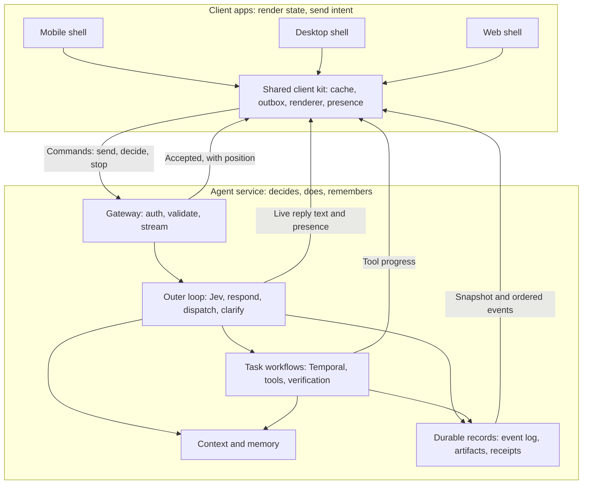

# Separation of concerns: agent service and client apps

**One agent service decides, acts and remembers. Every client renders state and sends intent.** Nori will run as a web app, a desktop app and a mobile app. They must never disagree about a conversation, a task, an approval or a memory, so all of that lives in the agent service. Clients meet the service through one contract: they send commands, and they receive an ordered event log plus a live stream. The client contract spec in the nori repo (`docs/client-contract.md`) defines that protocol.

See the [architecture](https://chatgpt.com/space/page_fb462c68ef1c8191be51107a6118d6ac), [outer loop](https://chatgpt.com/space/page_2c00c5ce6cac8191b153218029cf445e) and [inner loop](https://chatgpt.com/space/page_d13c42ea3c28819195803f7f280e5f65) for the agent design behind the service.

# The rule

**If two clients could disagree about it, the service owns it.** A client owns only how that state looks and feels on its own platform.

# System shape

There are three layers. Each one owns different work:

| Layer | Exists | Owns |
| - | - | - |
| Agent service | Once | Truth: what was said, what is running, what was approved, what happened, what Nori knows. |
| Shared client kit | Once, used by every client | How a client follows that truth reliably: caching, sending, retrying, rendering rules, presence. |
| Platform shell | Once per platform | How it looks and feels there: layout, navigation, input, OS integrations. |

# Ownership

| Concern | Agent service | Shared client kit | Platform shell |
| - | - | - | - |
| Threads and messages | Source of truth, ordering, IDs | Local cache, optimistic sends | Layout and scrolling |
| Prompts and context | Builds all of it | Never sees it | Never sees it |
| Model output | Turns it into typed parts (text, chips, artifacts, images) | Renders parts. Falls back to plain text for unknown ones | Platform styling |
| Live reply | Streams draft text. Supersedes stale replies | Paces the reveal word by word | Animation |
| Tasks | Lifecycle, status, waits, verified results | Mirrors the state | Shows task status and Stop |
| Stop | Applies it, then reports requested, stopping, stopped | Sends the command, shows each state | The button |
| Approvals | Binds each one to an exact operation. Rejects stale decisions | Sends the decision, shows the current state | Card and buttons |
| External effects | Prepared, attempted, submitted, confirmed or uncertain, with receipts | Shows the state honestly | Presentation |
| Soul and memory | Stores them with revisions. Nori updates them through tasks | Edits with conflict detection | Editor UI |
| Settings | Stores and enforces them (quiet hours, daily cap, proactive) | Sends changes | Settings screen |
| Notifications | Decides when and why to interrupt | None | Delivers it: push, tray badge, tab title |
| Badges and read state | One read cursor per thread, across all devices | Advances the cursor | Shows badges |
| Offline | Idempotent commands, replayable log | Outbox, retries, catch-up from the last position | Offline indicator |
| Avatar and presence | Emits turn, task and approval signals | Derives the avatar's mode from them | Draws the mark |
| Input | Accepts text, images and attachments | Uploads, then references | Keyboard, camera, share sheet, shortcuts |
| Drafts, open panels, active thread | None | None | Per device |

# Boundary rules

- **Clients send intent, never context.** A command carries only the owner's own words and references. It never carries system prompts, summaries or memory excerpts.
- **Clients never parse model output.** The service produces typed parts. A client that doesn't recognize a part shows its fallback text.
- **Acknowledgment isn't completion.** A command returns once it is durably accepted. Results always come back later as events.
- **Every change arrives as an event.** Clients don't infer state from their own actions, apart from showing an optimistic entry until it is confirmed.
- **Explicit controls skip interpretation.** Tapping Stop or Approve targets an exact task or operation. "Stop the research", typed in chat, goes through the conversation and gets interpreted.
- **Acknowledged, applied and stopped are different states.** So are prepared, submitted and confirmed. Clients show which one is true.
- **The service never assumes a form factor.** Events carry meaning and presentation hints, never layout.
- **Clients ignore what they don't recognize.** Unknown events, fields and part types are skipped or shown as fallback text, so old clients keep working as the service grows.

# Where things go

| Example | Owner | Why |
| - | - | - |
| Quiet hours and the daily cap | Service | Every device must honor them the same way. |
| Push notification | The service decides; the shell delivers | Whether to interrupt is shared. How to interrupt is per platform. |
| Bubble or page for a reply | The kit, using the service's hint | A presentation rule shared by every client. |
| Chips under a reply | The service generates them; the kit renders them | A tapped chip is just a new message. |
| Reply pacing | Kit | Purely visual. It never changes content. |
| A half-typed draft | Shell | Per device, unless deliberately synced later. |
| Which thread is open | Shell | Per device. |
| A task's outcome | Service, delivered to the thread that started it | Every device must show the same result in the same place. |
| An image the owner attaches | Shell captures it, kit uploads it, service stores it | Uploaded once, then referenced. Never sent inline. |

# What moves out of today's web app

The web demo currently does the service's job inside the browser. Under this split:

| Today, in the browser | Moves to |
| - | - |
| Domain state persisted in localStorage | Service records. The browser keeps a cache. |
| Building the prompt and system context | Service |
| Parsing chips, approvals and artifacts out of comment hints in model text | Service, which emits typed parts |
| Creating approval cards from chat text | Task workflows, bound to an exact operation |
| Posting "I tapped Approve" as a chat message | A decision command |
| Aborting a reply when a new message is sent | The service supersedes the stale turn |
| Checking quiet hours and the daily cap | Service notification policy |
| A route that spends the model API key | Service only |

What stays in the web app: the bubble-or-page rule, paced reveal, optimistic sending, layout, the agent panel, drafts, and drawing the avatar.

# Decisions this depends on

| Decision | Proposal |
| - | - |
| Stream scope | One ordered log and one stream per owner, not per thread. |
| Where task outcomes land | The thread that started the task, plus an activity entry. |
| Editing a sent message | A new message that supersedes the old one, treated as a correction. |
| Ideas, Goals, Upcoming | Stay client seed data until the service owns them. |
| Transport | Commands over HTTPS POST. Events over server-sent events, with a long-poll fallback. |
| Client authentication | Google sign-in through Identity Platform, verified at the gateway. |
